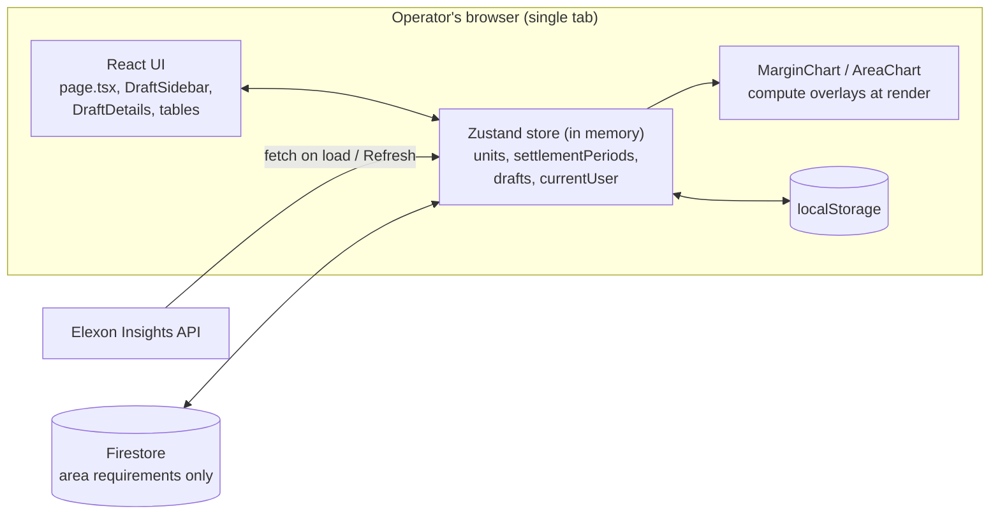
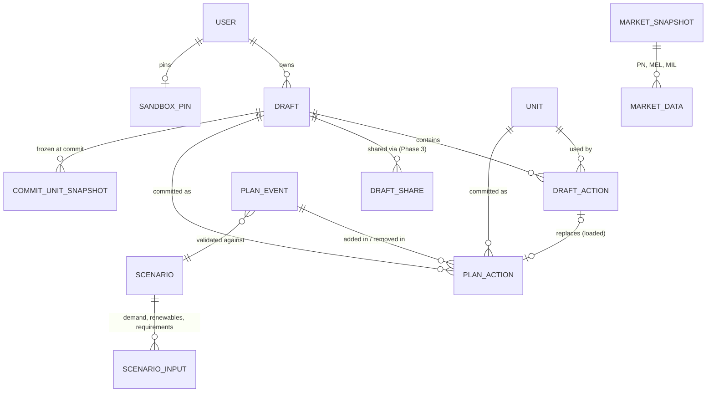
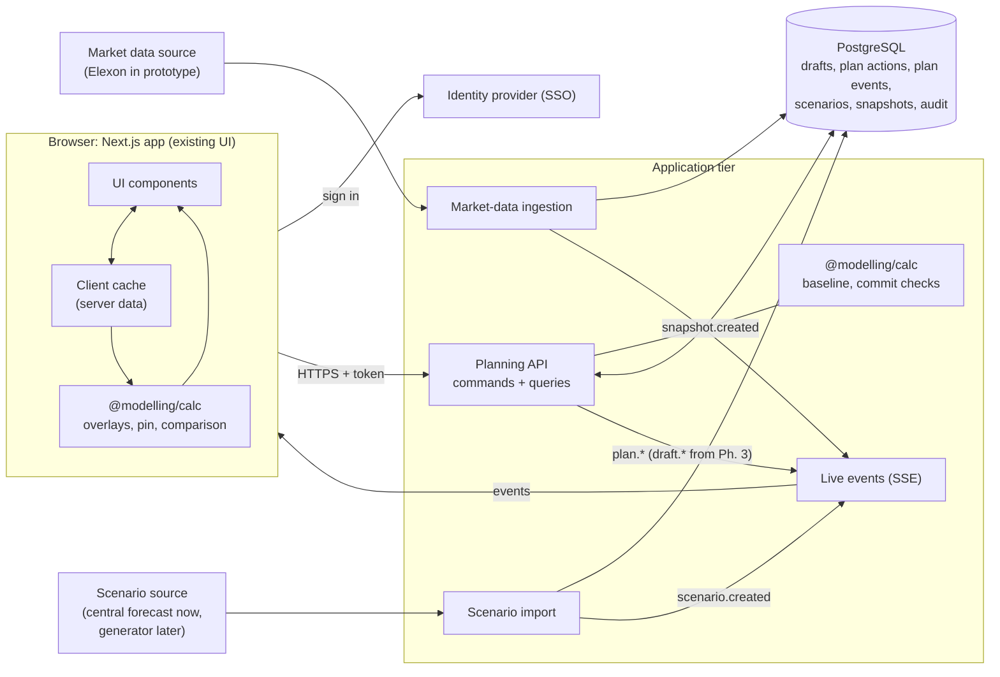
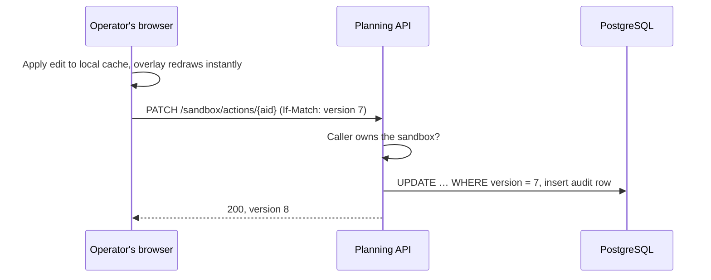

# Drafts: Current Implementation and Production Architecture

**Status:** the current state is described as of October 2026 (commit `5a9ef13`). The target architecture is a **proposal for discussion**. It incorporates the architecture review, the **sandbox brief** (day one = one private sandbox per operator, §13) and the **scenarios brief** (design seams for multiple scenarios, §14). Decisions are tracked in §23.1, and conflicts that still need a decision are flagged in §23.2.
**Audience:** product owner and solution architect.
**Diagrams:** open [`drafts-architecture-diagrams.html`](drafts-architecture-diagrams.html) in a browser for a visual walkthrough.

**How to read this document**

| Part | What it covers | Read if you want to… |
|---|---|---|
| **Mental model** (next section) | Drafts explained as GitHub pull requests: what to borrow and what not | get the idea in two minutes |
| **A. Current implementation** (§1–4) | How the prototype does drafts, dotted lines, commit and sharing | understand what exists and what is worth keeping |
| **B1. Logical model and rules** (§5–14) | Platform-independent design: concepts, data model, lifecycle, the committed plan, calculation and comparison rules, permissions, **day one sandbox**, **scenarios (future)** | agree *what* the system does |
| **B2. Reference implementation** (§15–21) | One way to build it (PostgreSQL, API, live events), with assumptions marked | discuss *how* to build it |
| **C. Delivery plan** (§22–24) | Phases, decisions, flagged conflicts, risks | plan the work |

**Releases at a glance:** Phase 1 (day one) = one private **sandbox** per operator, with the full committed-plan design. Phase 2 = multiple private drafts and side-by-side comparison. Phase 3 = sharing. Details in §22.

---

# Mental model: drafts are like GitHub pull requests

If you know GitHub, you already know most of this design. The committed plan is `main`. A draft is a pull request against it. The dotted line is the PR's diff view. Committing is merging. On day one each operator has a single **sandbox**, which is like a working copy: you stage changes, commit some or all of them, and keep going.

## The mapping

| GitHub / Git | Our drafts | Notes |
|---|---|---|
| `main` branch | **Committed plan**: the solid baseline every operator sees | One shared plan (D3). Stored as a versioned log (§9.1) |
| Working copy with staged changes | **Sandbox** (day one): one private working draft per operator | §13 |
| `git add -p` (stage only some changes) | **Partial commit**: commit selected sandbox units, keep the rest | D15 |
| Branch / pull request | **Named draft** (Phase 2): a proposed change on top of the plan | Holds intent (units + times), not results |
| "Files changed" view | **Dotted line**: the plan as it would be if the sandbox or draft went in | Computed live in the browser |
| Commits inside a PR | **Actions**, one per unit | §2.1a |
| Merge | **Commit**: actions are added to the plan | One transaction (§18.3) |
| Check out a merged change to amend it, then a follow-up PR | **Edit on a committed draft** = load it into the sandbox, change it, commit as a **supersede**: replaces the old in one step, with no gap | §8.3, D16, D20 |
| Revert commit | **Withdraw** (UI label may stay "Uncommit"): removes actions from an effective time onward. History is kept | §8.4, D17 |
| Closing a PR without merging | **Clear sandbox** (day one), **discard** a named draft (Phase 2) | |
| Fork | **Duplicate** (Phase 2) | |
| Reviewer / read access | **Share** (Phase 3) | |
| Merge conflict | **Clash**: same unit, overlapping half-hours. **Blocked**, so amend the existing commitment instead | D18 |
| Required review before merge | **Commit approval** | D4 |
| CI checks before merge | **Validation before commit**: clashes, effective-time warnings, drift since last edit, MNZT (if D14 = profiles) | §8.4, §11.3 |
| HEAD commit id | **Plan version** (`plan_seq`) | Tells browsers their baseline is stale |
| `git log` / blame | **Plan history**: plan actions with the version they were added and removed in | §9.5 |

Scenarios (§14) have no Git equivalent. They are the *environment* a change is tested in, like running the same PR's test suite against several configurations.

## Where the analogy breaks (and why the design differs)

1. **The base moves by itself.** `main` only changes when someone merges. Our baseline also changes every few minutes as new market data arrives. → Drafts store **intent**, not results, so they are re-applied to whatever the current baseline is. There is never a manual rebase.
2. **Drafts are usually competing alternatives.** Most PRs eventually get merged. Several drafts are often different answers to the same shortfall, and only one is committed. → Comparing options matters (pin on day one, comparison table in Phase 2, §11).
3. **Time runs out, and the past is fixed.** A PR can sit for months, and a revert undoes everything. A draft for 17:00 is worthless at 17:30, and half-hours already delivered can't be undone. → Real times, an **Expired** flag, and changes that apply only from an **effective time** (§8.4).
4. **Conflicts are about meaning, not lines.** Git compares text. We compare "same unit, same half-hour". → A rule enforced by the database, never a merge editor.
5. **Live, not pull-based.** Operators must see a colleague's commit within seconds. → Server-pushed live events (§19).
6. **Merging doesn't change other work.** Other operators' sandboxes and drafts redraw against the new baseline, and any unit now committed elsewhere stops counting (§10.3).

## Worth borrowing

| Idea from GitHub | What it means for us | Where it fits |
|---|---|---|
| **Protected `main`** | Only commit, supersede and withdraw can change the plan. Nothing writes to it directly | Built in (§9.1) |
| **Never rewrite history** | Plan actions are never edited or deleted. Changes close old rows and add new ones | Built in (§9.1) |
| **Staging only some changes** | Partial commit from the sandbox | Phase 1 (D15) |
| **Amend via a new change, not by editing merged code** | Edit loads a commitment into the sandbox, and committing supersedes it atomically | Phase 1 (§8.3) |
| **Checks before merge** | Clash, effective-time and drift checks are shown in the commit dialog before the operator confirms | Phase 1 |
| **Required review** | Optional senior approval before commit | D4 (Phase 4 if chosen) |
| **PR description** | The commit dialog asks for a name and description (*why*). Supersede and withdraw require a reason | Phase 1 |
| **Review comments** | Recipients of a shared draft can comment ("why not PEHE-1?") | Phase 4 (after sharing) |
| **Notifications** | "Your commitment was edited by NSE", later "OSM shared a draft with you" | Phase 1 (plan events), Phase 3 (sharing) |
| **History browsing** | "Show me the plan as it was at 14:00": a simple query over plan actions | Query in Phase 1, UI in Phase 4 |
| **Blame** | For any unit and half-hour: which commitment put it there, who committed it, when, and what it replaced | Query in Phase 1, UI in Phase 4 |

## Not worth borrowing

| Git / GitHub feature | Why not |
|---|---|
| **Git itself as the storage engine** | We need queries, transactions, constraints, row-level security and live events. A relational database does all of this |
| **Branches of branches / stacked PRs** | A draft is always against the current plan. To build on a colleague's draft, duplicate it. To see two drafts together, use the read-only combined preview (§11.2) |
| **Text diffs and three-way merges** | Our "diff" is a calculated MW delta per half-hour, and our "conflict" is a rule. There is nothing to merge line by line |
| **Manual rebase** | The baseline moves constantly, so drafts must re-apply automatically |
| **Pull-based sync** | Operators need changes pushed to them in seconds |
| **Long-lived drafts** | Drafts expire with time |
| **Force-push / history rewrite** | Breaks the audit trail. Never allowed |
| **Merge commits that combine several drafts** | Each commit is its own commitment record, which keeps "which option did we choose and why" clear |

---

# Part A: Current implementation

## 1. Short version

- A **draft** is a named list of "what if we bring these units on, for these settlement periods" decisions. It holds **no market data of its own**, only references to units and time slots.
- The app holds **one copy** of the market data (units and 48 settlement periods). It stores the **baseline** totals (EMX / EOL / EMI) once per settlement period.
- The dotted line for a draft is computed **when the chart draws**: *baseline + what this draft would add*. Nothing is precomputed or stored per draft.
- **Committing** a draft moves its units into the baseline, so the solid lines change.
- **Everything runs in the operator's browser.** No server, no database and no user accounts are involved in drafts. Drafts live in browser memory and **are lost on page reload, on Refresh, or when historical data is loaded**.
- **Sharing is simulated.** The seven operator identities (ANSE, NSE, OSM, OEM, NBE, TSM, TSE) are a drop-down in one browser. "Sharing" adds a name to a list on the draft, and you see the result by switching identity in the same tab.

### The user experience we achieved (to be kept)

| Capability | Prototype status |
|---|---|
| Create one or more drafts, each colour-coded | ✅ |
| Add and remove units, set per-unit time window, reason, event type, notes | ✅ |
| See each open draft as a **dotted line** on the Margin and area charts before committing | ✅ (Chart tab only) |
| Show or hide each draft's line from the sidebar | ✅ |
| Commit a draft so its units become part of the **solid baseline** everywhere | ✅ |
| Uncommit, discard, restore, delete, duplicate | ✅ |
| Share a draft with other operators: view-only, with "Duplicate to my drafts" | ✅ (simulated) |
| Preview an open draft's effect on the **Dashboard / Dashboard 2** tiles | ❌ Dashboards show the committed baseline only |

---

## 2. In plain English

### 2.1 What a draft is

An operator sees a shortfall in, for example, margin between 17:00 and 19:00. They want to try a few options before deciding. Each option is a **draft**: a working sheet that says *"bring on unit A and unit B from 17:00 to 19:00, for margin, as an Advanced Synch."*

A draft has a name, an optional description, a colour, a default time window, and a list of **actions**, one per unit. Each action records the unit, its start and end slot, the output level and the reason (Margin, Recovery Reserve, Inertia and so on).

### 2.1a One draft, many units (not one draft per unit)

A draft is a **container**. Each unit you add becomes one **action** (one row) inside it. A draft with five units is one draft with five actions, not five drafts.

```
Draft A  (owner NSE, default window 17:00–19:00)
 ├─ action: T_DRAXX-1   17:00–19:00   645 MW   Margin
 ├─ action: T_CNQPS-2   17:30–19:00   380 MW   Margin
 └─ action: T_PEHE-1    18:00–open    250 MW   Recovery Reserve

Draft B  (owner OSM)
 ├─ action: T_CNQPS-2   06:00–08:00   380 MW   Inertia     ← same unit as in Draft A: allowed
 └─ action: T_SHBA-1    06:00–09:00   400 MW   Response
```

(Unit names and figures are illustrative.)

Rules in the prototype:

- **A unit appears at most once in a draft.** Adding it again is ignored (`addUnitsToDraft` skips units already in the draft).
- **Each action has its own settings.** Window (From/To, editable per row in the Selected table; To can be left open), output level, **one** reason, event type and note. New actions copy the draft's default window. Changing the draft's From/To **resets every action's window** to match.
- **The same unit can be in several drafts**, including drafts owned by other operators. The Available table marks this with **●N** ("in N other drafts", names shown on hover). Each open draft's dotted line includes that unit independently.
- **Commit, discard, share and duplicate act on the whole draft**, never on one action.
- **If the same unit is committed in two drafts for the same half-hour, it is counted once, and the earliest-created draft's values win by accident** (`computeAggregates` keeps the first action it meets). The proposed design blocks this case (§9.2) and makes reason a list, so one commitment can serve several needs (§9.3).

### 2.2 The lifecycle

```
          ┌──────────── Uncommit ────────────┐
          ▼                                  │
  New → [ Draft ] ── Commit ──────────► [ Committed ]
          │  ▲                               │
  Discard │  │ Restore                       │ Discard
          ▼  │                               ▼
       [ Discarded ] ◄───────────────────────┘
          │
        Delete (gone for good)
```

- **Draft**: editable by its owner. It shows on the chart as a **dotted** line.
- **Committed**: read-only. Its units are now in the **solid** baseline on every chart, dashboard tile and cost card. Nothing is sent to a unit or a control system.
- **Discarded**: set aside. It does not count anywhere and can be restored or deleted.

The proposed lifecycle differs: committed drafts never become editable again. See §8.

### 2.3 Where the dotted line comes from

1. **The solid lines (the baseline).** For each half-hour, the app adds up every unit already running according to its Physical Notification (PN), plus every unit in a **committed** draft. This is worked out whenever data loads or the set of committed drafts changes, and stored against each settlement period.
2. **The dotted lines (each open draft).** When the chart draws, the app takes the stored baseline and adds the units in that draft that are not already counted.

Two rules:
- **No double counting.** A unit already running (PN above 1 MW) or already committed adds nothing for that half-hour.
- **The dotted line only appears where the draft changes something.** Elsewhere it is not drawn, so the solid line shows through. One anchor point on each side joins it to the solid line.

### 2.4 Why each draft doesn't need its own data set

A draft holds only unit IDs, time slots and a few settings. The heavy data (48 half-hours × hundreds of units) exists **once**. Drawing a draft needs only the stored baseline value plus the MEL / output / SEL of the few units in the draft. A draft is a **delta** on a shared baseline: ten drafts cost ten small lists, not ten copies of the market data.

### 2.5 How sharing works today

- Every draft has an **owner** and a **shared with** list. The owner manages the list using the share icon.
- After switching identity, the sidebar shows *your* drafts plus a **"Shared with me"** section.
- Shared drafts are **view-only**. The only action is **"Duplicate to my drafts"**.
- All of this happens inside one browser tab. Two operators on two PCs cannot see each other's drafts.

### 2.6 Where things are stored today

| What | Where | Survives reload? | Shared between machines? |
|---|---|---|---|
| Drafts (all statuses) | Browser memory (Zustand store) | **No** | **No** |
| Current identity | `localStorage['bm-current-user']` | Yes | No |
| Chart visibility of each draft | Browser memory (`page.tsx`) | No | No |
| Market data (units, PN, demand) | Browser memory, fetched by each browser from the public Elexon API | No (re-fetched) | No |
| Standing data cache (NDZ/MZT/MNZT/SEL) | `localStorage` | Yes | No |
| Area requirements | **Firestore** (`config/area_requirements`) | Yes | **Yes** (not draft data) |

---

## 3. Current architecture

### 3.1 Runtime topology



### 3.2 Data model (`src/models/types.ts`)

**`DraftPlan`**: `id`, `name`, `description`, `actions: ModellingAction[]`, `status: 'draft'|'committed'|'discarded'`, `color`, `fromPeriod`/`toPeriod` (default window, slot index 1–48), `unitNotes`, `createdAt`/`committedAt?`/`discardedAt?`, `ownerId`, `sharedWith: UserId[]`, `dataSnapshot?` (unit parameters frozen at commit).

**`ModellingAction`**: `bmUnitId`, `fromPeriod`, `toPeriod | undefined` (undefined = open-ended), `outputLevel` (MW, defaults to SEL → registered capacity → 100), `reasonCode` (one of 8 values), `operationType?`, `timestamp`.

**`SettlementPeriodData`** (48 rows, the shared data set): `settlementPeriod` (**slot index in the rolling window, not the real SP**), `settlementDate`, `startTime`, `pn`/`mel`/`mil` per unit, `demand`, baseline `emx`/`eol`/`emi`/`margin`, `areaAvailability`, `hasConfirmedPn`, `proxyEmx`/`proxyEol`.

**`UnitSnapshot`**: `mel, sel, ndz, mzt, mnzt, priceToSel, priceToMel`.

### 3.3 Store operations (`src/store/useModellingStore.ts`)

| Method | Effect | Recomputes baseline? |
|---|---|---|
| `createDraft` | New draft owned by `currentUser` | No |
| `addUnitsToDraft` / `removeUnitFromDraft` | Add or remove actions | Remove: only if committed |
| `updateDraftWindow` | Sets window **and overwrites every action's window** | Only if committed |
| `updateUnitWindow`, `updateUnitReason`, `updateUnitOperationType`, `updateUnitNotes`, `renameDraft`, `updateDraftDescription` | Field edits | Window only, if committed |
| `commitDraft` | Snapshot + `status='committed'` | **Yes** |
| `discardDraft` / `reopenDraft` | Status change | If it was committed |
| `deleteDraft` | Remove | No |
| `duplicateDraft` | Copy owned by `currentUser`, `sharedWith=[]` | No |
| `shareDraft` / `unshareDraft` | Edit `sharedWith` | No |
| `setCurrentUser` | Switch identity | No |
| `clearAllDrafts` | Wipe; called on every data load | If any were committed |

"Recomputes baseline" means calling `refreshAllAggregates`, which runs `computeAggregates` for every SP and then `computeAreaAvailabilities`.

### 3.4 The calculation: baseline + delta

**Baseline (stored)**, `computeAggregates` in `src/utils/margin.ts`:

```
for each unit in sp.pn with PN > 1 MW:
    EMX += sp.mel[unit] ?? PN;  EOL += PN;  EMI += SEL ?? MIL ?? 0
for each action in COMMITTED drafts covering this SP (once per unit):
    if unit PN ≤ 1 MW:
        EMX += sp.mel[unit] ?? 0;  EOL += outputLevel;  EMI += SEL ?? MIL ?? 0
```

**Draft overlay (computed at render)**, `applyDraftToBaseline` in `margin.ts`, called from `MarginChart.tsx`:

```
alreadyModelled = PN-running units ∪ committed units covering this SP
draft.EMX = sp.emx + Σ MEL of draft units covering this SP and not in alreadyModelled
(same for EOL and EMI)
draft margin = draft.EMX − TR2      (TR2 = demand × (1 + reserve%) + General Reserve requirement)
```

Non-margin areas use `applyDraftToAreaBaseline` in `src/utils/areaAggregates.ts` with per-area rules from `unitAreaContribution`. Area availability counts every committed unit's physical contribution to every area, whatever its reason code.

**Partial line.** Each draft is drawn as Recharts series `draft_<id>_emx|eol|emi`. A covered slot gets the overlay value, a neighbouring slot gets the baseline value (the anchor point), and every other slot gets `null` (not drawn).

### 3.5 Sharing and permissions (UI-only)

| Who | Sidebar | Edit / commit / discard / share | Duplicate |
|---|---|---|---|
| Owner | Editing / Committed / Discarded | Yes (edit only while `draft`) | Yes |
| In `sharedWith` | "Shared with me" | No | Yes |
| Others | Not listed | No | No |

---

## 4. Known limitations of the prototype

1. **No persistence.** A reload, **Refresh** or **Load historical data** wipes all drafts.
2. **Drafts reference slot indices, not absolute times.** After a refresh the window moves, so index 10 means a different half-hour. This is the main blocker for persistence.
3. **Sharing is simulated.** There is one tab, one memory space, and no authentication or transport.
4. **Permissions are UI-only.** Store methods don't check `ownerId`.
5. **The charts show every identity's open drafts,** not only yours and those shared with you (`MarginChart` / `AreaChart` filter only on status and visibility). The Available table's "in N other drafts" indicator also counts all identities' drafts.
6. **The baseline is global.** Any identity's commit changes everyone's solid lines. This is probably intended, but it is not stated anywhere.
7. **Non-margin overlay dedup is too broad.** `AreaChart` treats a unit as "already counted" if it is committed **anywhere in the window**. `MarginChart` checks **per SP**.
8. **Changing a draft's window resets per-unit windows.**
9. **No draft preview on the dashboards.** Tiles reflect committed data only.
10. **Each browser fetches its own market data,** so two operators can see slightly different baselines.
11. **The same unit committed twice: the first draft wins silently** (see §2.1a).
12. **Uncommit erases the past.** Uncommitting removes the whole draft from the baseline, including half-hours already delivered, and changing a committed draft means uncommit → edit → recommit, with a gap in between.

**What carries over to production:** the calculation model (§3.4), the draft and action structure (§3.2) and the UI. **What changes:** storage, identity, sharing transport, permission enforcement, and how the committed plan is stored and amended.

---


# Part B1: Logical model and rules

This part is **platform-independent**. It describes what the system does and the rules it enforces, whatever it is built with. Part B2 describes one way to build it.

The full model (named drafts, sharing) is described first, because day one is a restricted form of it. §13 describes **day one: the sandbox**, and which parts of the full model it switches off.

## 5. Goals and requirements

### 5.1 Functional parity: same user experience

| # | Requirement | From |
|---|---|---|
| F1 | An operator can create, rename, describe, duplicate, discard, restore and delete their own **named drafts** | Phase 2 |
| F2 | An operator can add and remove units, set each unit's window (open-ended allowed), output, **one or more reasons**, event type and notes | Phase 1 (in the sandbox) |
| F3 | The operator's work in progress is drawn as a dotted overlay on the Margin and area charts, updating **instantly** as they edit | Phase 1 |
| F4 | The operator can show or hide each draft's overlay | Phase 2 |
| F5 | Committing adds units to the **shared committed plan**. Every operator's solid lines update | Phase 1 |
| F6 | A committed draft can be **edited** (familiar flow, implemented as load + supersede, without a gap) or **withdrawn**. Both apply from an effective time and never change the past | Phase 1 |
| F7 | The owner can share a draft with named operators or a desk. Recipients see it read-only and can duplicate it | Phase 3 |
| F8 | Committed-data drift indicators (↑/↓ against the commit snapshot) continue to work | Phase 1 |
| F9 *(optional)* | Preview work in progress on Dashboard / Dashboard 2 tiles | **Flagged: C1** |
| F10 | Compare options side by side across all areas (§11.1) | Phase 2 |
| F11 | Preview two or more drafts combined, read-only (§11.2) | Phase 2 |
| F12 *(new)* | One private, persisted **sandbox** per operator, with clear, partial commit and load-from-plan (§13) | Phase 1 |
| F13 *(new)* | **Pin** one previous sandbox state as a reference while editing (§13.8) | Phase 1 |

### 5.2 Production requirements

| # | Requirement |
|---|---|
| N1 | **Persistence.** Sandboxes and drafts survive reloads, refreshes, restarts and new market data |
| N2 | **Real multi-user.** Operators on different machines see commits within seconds (and shared drafts from Phase 3) |
| N3 | **Identity.** Single sign-on. No self-selected identity |
| N4 | **Authorisation enforced server-side** |
| N5 | **Consistency.** All operators compute the baseline from the same scenario, market data and committed plan version |
| N6 | **Audit and history.** Every command is recorded. The committed plan at any past version can be reconstructed exactly |
| N7 | **Concurrency safety.** Commits and edits never silently overwrite each other. Two commitments for the same unit and half-hour can never both exist |
| N8 | **Time correctness.** Actions refer to real half-hours (UTC), including clock-change days (46/50 SPs). The past is never changed |
| N9 | **Availability** suitable for a control-room tool (target to be agreed, D12) |
| N10 | **Scenario-ready.** Every calculation takes the scenario as an explicit input, so more scenarios can be added later without a redesign (§14) |

---

## 6. Core concepts and invariants

### 6.1 Glossary

| Term | Meaning |
|---|---|
| **Draft** | An editable container of proposed actions, owned by one operator. Stores intent, never results. Has a **kind**: `sandbox` or named `draft` |
| **Sandbox** | The operator's single private working draft on day one (§13). A draft with restrictions, not a separate mechanism |
| **Action** | One unit inside a draft: window, output, reasons, event type, note |
| **Commitment** | A draft with status *committed*: the record of one commit (its name, description, units, unit-data snapshot) |
| **Committed plan** | The set of **plan actions** currently in force. One plan for everyone (D3), independent of scenario |
| **Plan action** | An immutable copy of an action, made at commit. Carries the plan version it was **added in** and, once closed, the version it was **removed in** |
| **Plan version** (`plan_seq`) | A counter incremented by every change to the plan (commit, supersede, withdraw) |
| **Load from plan** | Copy committed plan actions into the sandbox so they can be changed. Behind the **Edit** button |
| **Supersede** | Atomically close loaded plan actions from the effective time and add their replacements |
| **Withdraw** | Close a commitment's plan actions from an effective time onward (the prototype's "Uncommit") |
| **Effective time** | The half-hour boundary from which a plan change takes effect. Never in the past |
| **Pin** | A display-only copy of the sandbox's impact at one moment, kept as a reference line (§13.8) |
| **Market snapshot** | **Facts**: an immutable copy of PN, MEL, MIL and standing data at a point in time |
| **Scenario** | **Assumptions**: one coherent set of demand, renewable forecasts and requirements (§14). Exactly one ("central") until multi-scenario working is built |
| **Baseline** | Per half-hour totals for (scenario, snapshot, plan version): units already running plus the committed plan |
| **Overlay** | Baseline + the delta of the sandbox or a draft: the dotted line |

### 6.2 Principles

1. **Drafts are intent, not results.** They are re-applied to whatever the current baseline is, and nothing is stored per draft.
2. **The committed plan is a versioned log, not mutable state.** It changes only by adding plan actions or closing them, never by editing them.
3. **Baseline + delta.** The baseline is computed once per (scenario, snapshot, plan version). Each draft is a delta on top of it.
4. **Absolute time.** Every action uses UTC half-hour boundaries. Slot indices exist only on screen.
5. **Commands, not raw writes.** Intent-level commands are validated and applied atomically, with an audit record and an event.
6. **One calculation library**, with the scenario and the contribution model (D14) as explicit inputs.
7. **Day one restricts, later phases lift.** The sandbox, single scenario and lack of sharing are restrictions on the full model, never separate mechanisms.

### 6.3 Invariants (always true)

| # | Invariant |
|---|---|
| I1 | The committed plan at version N is exactly the plan actions with `added_in ≤ N` and (`removed_in` empty or `removed_in > N`) |
| I2 | A plan action is never edited. The only change ever made to it is setting `removed_in`, once |
| I3 | At any plan version, **no two plan actions for the same unit overlap in time** (D18) |
| I4 | A commitment's contents never change. Its plan actions can only be closed |
| I5 | No command changes a half-hour that has already started: effective times are never in the past (D17) |
| I6 | A unit appears at most once in a draft |
| I7 | Every action has at least one reason |
| I8 | **Day one:** each operator has at most one open draft, their sandbox (lifted in Phase 2) |
| I9 | No calculation reads forecasts or requirements from global state. The scenario is always passed in |
| I10 | The committed plan is scenario-independent. Each plan change records the reference scenario it was validated against |

---

## 7. Logical data model



| Entity | Key attributes | Notes |
|---|---|---|
| **User** | identity, role, desk | From SSO |
| **Draft** | owner, **kind** (`sandbox` / `draft`), name, description, status, default window, context (live / historical), version (concurrency), last-evaluated impact (drift check), source (the sandbox a commitment came from) | Status: `draft` (open), `committed`, `superseded`, `withdrawn`, `discarded` |
| **Draft action** | unit, start, end (empty = open-ended), output, **reasons (list, ≥ 1)**, event type, note, **replaces** (the plan action it was loaded from, if any), **removal** flag (a loaded unit the operator deleted, to be withdrawn at commit) | Unique per (draft, unit) |
| **Draft share** | draft, grantee (user **or** desk), permission (view) | Phase 3. Desk shares follow desk membership |
| **Plan action** | source commitment and action, unit, start, end, output, reasons, event type, `added_in`, `removed_in`, `split_from` | Immutable (I2). See §9 |
| **Plan event** | plan version, time, actor, type (`commit`, `supersede`, `withdraw`), commitment, effective time, reason, acknowledged warnings, **reference scenario**, impact summary | Append-only. One per plan change |
| **Commit unit snapshot** | commitment, unit, MEL, SEL, NDZ, MZT, MNZT, prices | Drives ↑/↓ drift arrows and indicative cost |
| **Sandbox pin** | owner, pinned at, scenario, snapshot, plan version, per-area impact series | Display only. One per user. Never committable |
| **Scenario** | name, source (generated / manual), generator run, valid from/to, description, metadata (e.g. what makes it distinct), status (active / superseded / retired) | Imported and read-only. A new run creates new rows. One "central" scenario until multi-scenario working |
| **Scenario inputs** | per half-hour demand, wind, solar, …; per half-hour and area requirement | **Assumptions.** Moved out of the market snapshot |
| **Market snapshot** | time taken, kind, per unit PN / MEL / MIL, standing data | **Facts.** Immutable. No demand |
| **Audit event** | actor, time, entity, command, before, after | Append-only |
| *Optional (D14)* **Action profile** | action, half-hour, MW, source (generated / override) | Only if unit profiles are chosen |
| *Optional (D19)* **Delivery status** | plan action → committed / instructed / delivered / lapsed, or a link to instruction records | Room left, not built in the first release |

**Time model.** Starts and ends are UTC half-hour boundaries, and the end is exclusive. They are displayed as Europe/London settlement date + SP (tested rules exist in `src/dashboard2/time.ts`, including 46/50-SP days). An action whose end has passed is **expired**. It is excluded from **forward-looking** views (overlays, comparison, commit checks) but **kept in history views and the plan record**.

---

## 8. Lifecycle and commands

### 8.1 States

The full model (Phase 2 onwards). The day-one sandbox uses a subset (§13.6).

```
                       Commit (all or selected units)
  New → [ Draft / Sandbox ] ─────────────────────────────► [ Committed ] ── Withdraw (from effective time) ──► [ Withdrawn ]
          │  ▲          ▲                                       │
  Discard │  │ Restore  │ Edit = load into sandbox              │ when all its plan actions are replaced
  (Ph. 2) ▼  │          └───────────────────────────────────────┤
     [ Discarded ]                                              ▼
          │                                               [ Superseded ]
        Delete
```

- **Draft / sandbox**: editable by the owner. Dotted line.
- **Committed**: a commitment. Its plan actions are in the plan. Its contents **never change** (I4) and it **never returns to draft**. To change it, load it into the sandbox (§8.3).
- **Superseded / Withdrawn**: all of its plan actions have been closed (by supersede or withdraw). Earlier half-hours stay in the plan record. If only some of them are closed, it stays *committed* with a "partly amended" badge (see C3).
- **Discarded** (Phase 2): a named draft set aside. Restorable. Can be deleted.
- **Expired** is a display flag on any draft whose actions are all in the past.

### 8.2 Commands

| Command | Applies to | Effect on the plan | From |
|---|---|---|---|
| Add / change / remove units, reasons, window | Sandbox or draft (owner) | None | Phase 1 |
| **Clear sandbox** | Sandbox | None. Loaded units go back to being untouched commitments | Phase 1 |
| **Commit** (all, or selected units) | Sandbox or draft | Adds plan actions from the effective time (§8.4). Selected units move into a new **commitment**. Unselected units stay | Phase 1 |
| **Edit** = load from plan | A commitment (or some of its units, see C3) | None until commit. Loaded units are copied into the sandbox, linked to the plan actions they replace. **Warns if the sandbox isn't empty** | Phase 1 |
| Commit with loaded units (= **supersede**) | Sandbox | One transaction: closes the loaded plan actions from the effective time (split at T), adds the replacements, and withdraws loaded units the operator deleted. One new plan version | Phase 1 |
| **Withdraw** | Commitment | Closes its plan actions from the effective time. New plan version | Phase 1 |
| **Pin** / unpin | Sandbox | None (display only) | Phase 1 |
| Create / rename / duplicate / discard / restore / delete named drafts | Draft (owner) | None | Phase 2 |
| Share / unshare | Draft (owner) | None | Phase 3 |

### 8.3 Editing a committed draft (D16, D20)

Operators keep a familiar **Edit** button on committed drafts. Under the sandbox model:

1. **Edit loads the commitment into the operator's sandbox.** If the sandbox already has content, the operator is **warned** first ("Your sandbox has 3 units. Loading Draft A will add to them, and they will be committed together"), and can cancel, clear first, or continue (see C4).
2. Loaded units are copies, each linked to the plan action it replaces. **The commitment stays in the plan** while the operator works, so nobody sees a gap or a false shortfall.
3. The dotted line shows **the plan with the loaded actions replaced** by the sandbox's version, not "plan plus a second copy" (§10.2).
4. Deleting a loaded unit marks it for removal: it is shown struck through and is withdrawn at commit.
5. **Commit** performs a supersede (one transaction, one plan version). **Clear** cancels, and the commitment is untouched.
6. If someone else changes the same plan actions first (e.g. a senior operator), committing fails with a clear message, and the operator reloads.

From Phase 2, Edit could instead open the commitment in a new named draft. Revisit with D20.

Committed records stay immutable while the operator flow stays familiar. **This user-experience choice is D20, for operator sign-off.** It does not block the build.

### 8.4 Effective-time rules (D17)

Every command that changes the plan (commit, supersede, withdraw) takes effect from an **effective time**: a half-hour boundary.

| Rule | Type | Detail |
|---|---|---|
| **Never in the past** | **Hard**: rejected | The effective time must be ≥ now. The earliest allowed value is therefore the **start of the next half-hour**, because the current one has already started. Default = earliest allowed. The operator may choose a later boundary |
| **Within gate closure** | Warning: acknowledge to continue | Effective time earlier than gate closure for that half-hour (≈ 1 hour before delivery) |
| **Within unit notice time** | Warning: acknowledge to continue | For units being added or extended: effective time earlier than now + the unit's NDZ (notice to deviate from zero) |
| *Minimum run / off time* (if D14 = profiles) | Warning | Window shorter than MNZT, or a gap shorter than MZT |

Acknowledged warnings are stored on the plan event and in the audit trail.

How the effective time applies:
- **New units:** action parts before the effective time are clipped off. An action entirely before it can't be committed (it has expired).
- **Loaded or withdrawn plan actions:** those entirely before the effective time are untouched. Those entirely after it are closed. An action spanning it is **split**: the original is closed, and a new plan action covering start → effective time is added (`split_from` links them). The past stays in the plan exactly as it was.

### 8.5 Historical mode

Work done against a historical snapshot carries `context = historical`. It behaves like live work for modelling, but **can never change the live plan**. Whether it can be committed to a per-user sandbox plan is D10. How this fits with one sandbox per user is flagged as C10.

---

## 9. The committed plan

### 9.1 A versioned log of plan actions

On commit, the selected actions are **copied** into the plan as plan actions, stamped with the new plan version (`added_in`), and **moved into a new commitment record** (a draft with status *committed*, named in the commit dialog). The sandbox keeps any unselected units (§13.7).

- **Current plan** = plan actions not yet closed.
- **Plan at version N** (or at 14:00) = invariant I1. It's a query, not a reconstruction.
- **Changing the plan** only ever closes plan actions (sets `removed_in`) and adds new ones, in one transaction per plan version.

### 9.2 One commitment per unit per half-hour (D18)

**A unit can have only one open plan action at any moment** (invariant I3). A commit that would overlap an existing commitment for the same unit is **rejected**, and the message names the clashing commitment and owner.

- To change a unit's commitment, **Edit** it (load into the sandbox, §8.3). The supersede closes the old plan actions before adding the new ones, so it never clashes with itself.
- This removes the prototype's "which value wins?" ambiguity (§2.1a) instead of resolving it with a rule.
- It replaces D5: there is no "warn and acknowledge" for clashes.

### 9.3 Reasons are a list

**One unit, one commitment, many reasons.** Each action carries a list of reasons (at least one), e.g. `[Margin, Inertia]`. Together with §9.2, if two operators need the same unit for different purposes, the second **edits the existing commitment to add their reason** instead of committing a duplicate.

| Where reasons are used | Rule |
|---|---|
| Area availability (calculation) | **Not affected.** A committed unit contributes physically to every area, whatever its reasons (as today) |
| Committed tab cost cards, per-reason breakdowns | A unit appears under **each** of its reasons. **Totals count it once.** Per-reason figures can add up to more than the total, and the UI says so |
| Dashboard tile alerts filtered by reason | A unit matches if the reason is in its list |
| Migration from the prototype | `reasonCode` becomes `[reasonCode]` |

### 9.4 Supersede and withdraw in one picture

```
Plan version N:    A  DRAXX-1  15:00 ─────────────────────── 19:00
Edit A (load into sandbox), trim to 18:00, effective 16:30, committed at 16:10:
Plan version N+1:  A  DRAXX-1  15:00 ──── 16:30                       (split: past kept, rest closed)
                   A′ DRAXX-1             16:30 ──── 18:00            (added in the same version)
```

Without supersede, the old flow (uncommit, edit, recommit) produced a version with nothing committed, which every screen showed as a shortfall, and it also erased 15:00–16:30.

### 9.5 History and blame

- **Plan at time T:** find the plan version current at T, then apply I1.
- **Blame (unit, half-hour):** the plan action covering it, plus its commitment, the plan event that added it (who, when, reason, reference scenario), and what it replaced (`split_from`, and the closed plan actions in the same plan event).
- **Lineage:** the plan events chain one commitment to the ones that amended it.

### 9.6 Room for instruction and delivery (D19)

Committing does not instruct a unit. A production tool will eventually need to know whether a plan action was **instructed** and whether it **delivered**, to reconcile plan with reality. The model leaves room for this with an optional delivery status on plan actions (committed / instructed / delivered / lapsed) or a link to instruction records. It is not built in the first release.

---

## 10. Calculation rules

### 10.1 Baseline + delta, with explicit inputs

- **Baseline** for (scenario, snapshot, plan version): units already running (PN > 1 MW) plus open plan actions, **once per unit per half-hour**, evaluated against the scenario's demand and requirements.
- **Overlay** for the sandbox or a draft: baseline + its units that aren't already counted in that half-hour.
- **Explicit inputs.** Calculation functions take the scenario as an argument, e.g. `computeBaseline(snapshot, scenario, plan)` and `applyDraft(baseline, scenario, draft)`. Nothing reads "the forecast" or "the requirement" from global or store state (I9).
- **One contribution function** answers "what does this action add in this half-hour?" for every area. Today it returns a flat block. It is the switch point for D14 (§10.4).

### 10.2 Rules

- **No double counting per half-hour**, for margin and all areas (fixes prototype limitation 7).
- **Loaded units are drawn as replacements.** For a sandbox containing loaded units, the overlay is *baseline − the loaded plan actions' contribution (from the effective time) + the sandbox's contribution*. The calculation library computes the loaded contribution with the same function and subtracts it. Loaded units marked for removal subtract and add nothing.
- **Visibility:** draw only the user's own sandbox and drafts, plus (Phase 3) drafts shared with them, minus any they have hidden (fixes limitation 5).
- **Expired actions** are excluded from forward-looking views and kept in history views (§7).
- **Open-ended actions** run to the end of the displayed horizon.
- **Partial line with anchor points:** unchanged.

### 10.3 The moving baseline

When the baseline changes (new snapshot, new scenario run, or someone else changes the plan), every overlay is recomputed. Nothing is stored per draft, so nothing needs migrating. If a unit in my sandbox is now committed by someone else, my overlay stops counting it, and the UI flags it ("already committed by OSM at 14:32; Edit that commitment to change it").

### 10.4 Open decision D14: how each unit's contribution is modelled

**Already settled:** a draft's impact is the **sum of its units' contributions** per half-hour. Lifecycle, the plan model and the API are the same for both options.

**Open:** the *shape* of each unit's contribution over time.

#### Option A: flat block (what the prototype does)

Each action has a start, an end and one output level. For every half-hour from start to end, the unit adds the same amount: EMX += MEL, EOL += output, EMI += SEL.

```
MW │    ┌───────────┐
   │    │           │
   └────┴───────────┴────
       start       end
```

#### Option B: unit profile

Each action has a start, an end **and a MW value per half-hour**, generated from the unit's data (NDZ, SEL, MEL, run-up / run-down rates, MNZT / MZT) and editable by the operator for individual half-hours. The draft impact is the sum of the profiles.

```
MW │            ┌────┐
   │          ╱      ╲
   │        ╱          ╲
   └──┬───┴──────────────┴──
    start notice ramp  hold  ramp down
```

#### Comparison

| | Option A: flat block | Option B: unit profile |
|---|---|---|
| Realism | Overstates contribution in the first half-hours. Ignores notice time and ramping | Contribution follows notice, ramp-up, hold and ramp-down |
| MNZT / MZT | Not checked | Warnings (§8.4) |
| Per-unit breakdown on the chart | Possible, but every unit is a rectangle | Meaningful ("of +1,200 MW at 18:30, DRAXX-1 gives 645") |
| Clash rule (D18) | By overlapping windows | Same rule. Windows still define the commitment |
| Operator effort | Pick units and a window | Same by default. Optional per-half-hour edits |
| Data needed | What we already have | Plus run-up / run-down rates: **not fetched today**, availability to be confirmed |
| Rules needed | None | Agreed ramp and notice rules, plus a definition of the EMX / headroom a ramping unit contributes |
| Build effort | Lowest | Profile generator, profile editor, more tests |
| Storage | Output on the action | Plus a profile per action, copied to the plan on commit |

#### Questions to answer before choosing

1. Do operators need notice and ramp realism in a planning tool, or is "on from start to end" an accepted simplification?
2. Are run-up / run-down rates available for the units we care about?
3. If a unit is ramping, does it count towards EMX from the start of the ramp, or only once at full output?
4. Should operators be able to edit a generated profile, and should that be audited separately?

#### Keeping the decision open (no regret)

A flat block is a profile with the same value in every half-hour. With the single contribution function (§10.1) in place from Phase 1, choosing Option B later means changing that function, adding profile storage and building the editor. Nothing else changes.

---

## 11. Comparing options

The main reason for having several drafts is choosing between them. **Day one** has one sandbox, so comparison is limited to **pinning one previous state** (§13.8). **Phase 2** brings the comparison table and the combined preview below, alongside multiple named drafts.

### 11.1 Comparison table (Phase 2)

Select two or more drafts and open **Compare**. Drafts are columns, with the current plan as the first column.

| Row | Content |
|---|---|
| Per area (Margin, each reserve, Response, Inertia, Voltage) | Worst headroom over the horizon, and how it changes vs the current plan. Red if still short |
| Half-hours still short | Count across all areas |
| Units / MW added | Counted once per unit |
| Indicative cost | From unit price data. **Labelled indicative**: prices are placeholders until real offer data is integrated |
| Would clash | Units already committed elsewhere, so this draft would be rejected as it stands (D18) |
| Warnings | Gate closure / notice warnings at the default effective time |
| For a draft with loaded units | Shown as a change against the commitment it replaces |

It is computed in the browser from the same overlays. With multiple scenarios (§14) it extends from drafts × areas to drafts × areas × scenarios.

### 11.2 Combined preview (Phase 2, read-only)

Select two or more drafts and choose **Preview together**. You get one extra overlay, "A + B", plus a column in the comparison table.

- It is **read-only and never stored**. It does not create a draft, so the "no drafts built on drafts" rule still holds.
- A unit that appears in both drafts is counted once. If its settings differ, the preview flags it and uses the first-selected draft's version, because committing both as they stand would be rejected (D18).

### 11.3 The moving baseline while comparing

- **Drift check at commit (Phase 1):** the sandbox records the impact it had when last edited (scenario, snapshot, plan version, per-area worst headroom). The commit dialog recomputes against the latest data and flags a **material change**, e.g. an area's status changes or headroom moves by more than a configurable threshold.
- **Freeze market data (optional, later):** hold the display on one market snapshot while weighing options, with a banner saying so. Commit always validates against the latest data. (This was called "pin a snapshot" before. It is renamed so it isn't confused with the sandbox **pin**, see C7.)

### 11.4 Dashboard preview

Showing work in progress on the Dashboard tiles is **flagged as C1**. The sandbox brief puts it on day one, while D13 says later.

---

## 12. Roles and permissions

| Action | Owner | Shared with (view) | Other operator | Senior operator | Viewer | Admin | From |
|---|---|---|---|---|---|---|---|
| Use own sandbox (edit, clear, pin, commit) | ✅ ² | — | — | — | ❌ | — | Phase 1 |
| See another operator's sandbox | — | — | ❌ | ❌ (D28) | ❌ | ❌ | Phase 1 |
| Edit (load + supersede) a commitment | ✅ | ❌ | ❌ | ✅ ³ | ❌ | ✅ | Phase 1 |
| Withdraw a commitment | ✅ | ❌ | ❌ | ✅ ³ | ❌ | ✅ | Phase 1 |
| See the committed plan, its history and blame | ✅ | ✅ | ✅ | ✅ | ✅ | ✅ | Phase 1 |
| Named drafts: create, edit, discard, restore, delete | ✅ | ❌ | ❌ | ❌ | ❌ | ✅ | Phase 2 |
| See a named draft & overlay | ✅ | ✅ | ❌ | ❌ ¹ | ❌ | ✅ | Phase 2 / 3 |
| Share / unshare | ✅ | ❌ | ❌ | ❌ | ❌ | ❌ | Phase 3 |
| Duplicate, compare, preview together | ✅ | ✅ | ❌ | ❌ | ❌ | ✅ | Phase 2 / 3 |

¹ Option: senior operators see all open drafts (D7).
² Option: commit requires senior approval (D4).
³ Covers the case where the owner has gone off shift (D6). The senior loads the commitment into **their own** sandbox. A reason is mandatory.

---

## 13. Day one: the sandbox

### 13.1 What it is

Each operator has **one private working area**, the sandbox. They add and remove candidate units and see the impact immediately as dotted lines on the charts, across all operational areas (and on the dashboard, see C1). When they commit, the selected units go into the committed plan, and the sandbox keeps whatever wasn't selected, ready for the next piece of work.

For the operator: one draft at a time, play freely, commit, carry on.

### 13.2 A sandbox is a restricted draft

A sandbox is **not a separate mechanism**. It is a draft (`kind = sandbox`) with restrictions:

| Restriction | Day one | Lifted in |
|---|---|---|
| One open draft per user | Enforced (partial unique index) | Phase 2 (multiple private drafts) |
| Private, never shared | Enforced | Phase 3 (sharing) |
| Committed units leave the sandbox | Behaviour of the commit command | Stays. In Phase 2 a named draft closes when fully committed |

It uses the same tables, the same `@modelling/calc` functions, the same overlay rendering and the same commit command as the full model. Moving to multiple drafts later means removing the one-per-user rule and adding UI, not changing the model.

**Do not** implement the sandbox as a list held only in UI state, or as a separate "sandbox" table. Both would have to be thrown away in Phase 2.

### 13.3 What stays exactly the same on day one

The hardest part of the architecture is the committed plan, and the sandbox does not simplify it. All of these are required on day one:

- Immutable plan actions with plan versions (§9.1), and audit of every command.
- Blocking overlapping commitments for the same unit, enforced by the database and safe against concurrent commits (§9.2).
- **Supersede** and the **effective-time split** (§8.3, §8.4), because operators still need to amend committed actions.
- Live events for **plan** changes, so every operator's solid lines update when anyone commits.
- The **scenario seams** (§14.4).

### 13.4 What day one leaves out

- Sharing, "Shared with me", share permissions and desk shares.
- The draft list in the sidebar, draft colours, and per-draft show/hide toggles.
- Discard, restore, delete and duplicate.
- The "in N other drafts" indicator.
- Live events for drafts (`draft.*`). Plan events (`plan.*`) remain.
- The comparison table and combined preview (Phase 2).

### 13.5 Required on day one

1. **Persisted server-side.** "Temporary" means "committed units leave", not "lost on refresh, reload or new market data". Losing work to a page reload would damage operator trust.
2. **Clear sandbox.** One command to empty it without committing.
3. **Partial commit (D15).** The operator selects which sandbox units to commit. Those go into the plan, and **the rest stay in the sandbox**. The default is commit all.
4. **Commit dialog.** Name and description for the commitment, effective time, warnings to acknowledge, clashes, impact against the current baseline, and a flag if it has changed since the sandbox was last edited.
5. **Load from plan (Edit).** Load a commitment into the sandbox to amend it, committed as a supersede. Warns if the sandbox isn't empty (§8.3).
6. **Pin** one previous state (§13.8).

### 13.6 Sandbox lifecycle

```
                    add units  /  Edit (load from plan; warn if not empty)
    [ Empty ] ─────────────────────────────────────────────────────► [ Has work ]
        ▲                                                               │  │  │
        │ Commit all                                                    │  │  │ Pin (display only)
        ├───────────────────────────────────────────────────────────────┘  │  ▼
        │ Clear                                                            │ (reference line)
        └──────────────────────────────────────────────────────────────────┘
                                                Commit selected → stays in [ Has work ] with the unselected units
```

### 13.7 What commit does to the sandbox (recorded choice; see C5)

The sandbox brief left a choice: remove the committed actions from the sandbox, or close the sandbox and open a new one. This document records a third option, which keeps the audit trail clearest:

- The **selected actions move into a new commitment record**: a draft row with `kind = draft`, `status = committed`, named in the commit dialog, with `source = this sandbox`. Plan actions point at this record.
- The **sandbox row stays open** with the unselected units. It keeps a stable identity, and the one-per-user index is never briefly violated.

Why: a commitment must never change after commit (I4). If plan actions pointed at the sandbox row, which keeps changing, that invariant would break, and the Committed tab could no longer group units by commitment.

### 13.8 Pin: day-one comparison

The main value of multiple drafts is comparing competing options. With one sandbox, the operator would have to swap units in and out and remember the numbers. Day one mitigates this with a **pin**:

- **Pin** keeps the current sandbox impact as a faded reference line on the charts, while the operator keeps editing.
- **One pinned state per user.** Pinning again replaces it.
- A small **"Pinned vs now" panel** shows per-area worst headroom for both. The sandbox brief kept these figures in the comparison table, which is now Phase 2, hence this panel (C6).
- It is **display state only**: stored per user, not a draft, never committable.
- It is **not recomputed** when data changes. It is a recorded picture of the moment it was pinned, labelled with its time, and the panel shows when it has become stale.

Phase 2 replaces the pin with real multiple drafts and the comparison table.

### 13.9 Path to Phases 2 and 3

| Phase | Main change |
|---|---|
| 2: multiple private drafts | Drop the one-per-user index. Add named drafts (`kind = draft`), sidebar list, colours, show/hide, discard / restore / delete / duplicate, comparison table, preview together |
| 3: sharing | Add `draft_shares`, desk shares, draft live events, read-only view, duplicate to own |

Multiple private drafts come before sharing, because comparing options is far more valuable to operators than sharing them.

---

## 14. Scenarios (future): design for it, don't build it

### 14.1 What a scenario is

A **scenario** is a coherent set of input variables describing one plausible future state of the system: demand, wind and solar forecasts, and the requirements derived from them (reserve, response, inertia, area requirements, and so on). Every tile, chart and margin figure is calculated against a scenario. Today there is exactly one, and it is implicit.

Two things vary independently:

| | Drafts | Scenarios |
|---|---|---|
| What varies | What **we** do (unit commitment) | What the **world** does (forecasts, requirements) |
| Who creates them | Operators | Mainly a scenario generator |
| Stored as | Intent (units, times, settings) | A coherent bundle of input values |

```
result = evaluate(scenario, market snapshot, committed plan, draft)
          assumptions     facts             what we've done   what we might do
```

Because drafts store intent, the same draft can be evaluated against any scenario unchanged. Multi-scenario working is therefore a grid: **drafts × scenarios**.

### 14.2 Where scenarios come from

Mostly from a **scenario generator**. A scenario is only useful if it is:

1. **Credible.** The combination of values is plausible together. Variables are correlated (wind, temperature, demand), so values must never be mixed across scenarios or edited one variable at a time.
2. **Decision-relevant.** It stresses the system in a way that calls for a distinct set of actions. Two scenarios that lead to the same actions add nothing.

Credibility and distinctness are the generator's job. The tool **consumes** scenarios and does not generate them.

A lesser, second source: **manual what-if scenarios**, where an operator applies an alternative profile (e.g. a different wind percentile). These must be labelled as user-defined and not credibility-assured. (The scenarios brief calls these "manual sandbox scenarios". They are renamed here so they aren't confused with the operator's sandbox, see C8.)

### 14.3 Future capabilities (not to build now)

- Evaluate one draft against several scenarios and see impacts per area per scenario.
- Comparison table extended to drafts × areas × scenarios.
- Identify **robust options**: drafts that satisfy requirements in more than one scenario.
- Feedback to the generator: if the same draft clears two scenarios, they are not decision-distinct.

### 14.4 Seams to build in now (Phase 1, cheap, no regret)

1. **Scenario is a first-class entity with exactly one instance** ("central"). Forecasts and requirements carry a scenario id.
2. **Separate facts from assumptions.** PN, MEL, MIL and standing data are facts and stay in the market snapshot. Demand, renewable forecasts and requirements are assumptions and belong to the scenario. **Demand moves out of `market_sp`.**
3. **The scenario is an explicit argument to `@modelling/calc`** (§10.1, I9). This is the most important seam, the same pattern as D14.
4. **Baseline cache keyed by (scenario, snapshot, plan version).**
5. **The committed plan is scenario-independent.** Each plan event records the reference scenario it was validated against (I10).
6. **Impact results keyed by scenario** wherever they are computed or cached: overlays, the pin, the drift check, and the commit-time impact in the audit record.
7. **Scenarios are imported, versioned and read-only.** A new generator run creates new rows rather than editing old ones, the same immutability principle as plan actions.

Open questions that touch today's prototype are flagged as C9: operator-entered requirements and the reserve % setting are both assumptions.

### 14.5 Not to build now

- Multi-scenario UI, a scenario selector, or scenario management screens.
- Weighting, probabilities or expected values across scenarios.
- Searching or optimising for options that satisfy several scenarios.
- Integration with a scenario generator.

---

# Part B2: Reference implementation

This part describes **one way** to build Part B1, based on the prototype's stack. It will be shaped by organisational standards, existing platforms and internal data feeds.

## 15. Assumptions

| Area | Assumption in this document | Likely in a real system |
|---|---|---|
| Market data source (facts) | Public Elexon Insights API (as in the prototype) | **Internal operational data feeds.** The public API is a prototype convenience |
| Scenario source (assumptions) | One "central" scenario built from the current demand forecast and the Requirements tab | Scenario generator output (§14) |
| Database | PostgreSQL | Organisation's standard relational database. The no-overlap rule (I3) needs equivalent support |
| Live updates | Server-Sent Events | Organisation's messaging / push standard |
| Front end | Existing Next.js app | Likely kept |
| Hosting | Not specified | Organisation's platform |
| Identity | OIDC SSO (e.g. Entra ID) | Organisation's identity provider |

## 16. Components

### 16.1 Component diagram



### 16.2 Components

| Component | Responsibility |
|---|---|
| **Web client** | Existing UI. A client cache of server state. Computes overlays, the pin and (Phase 2) comparison locally. Edits are applied optimistically and confirmed by the server |
| **Planning API** | Commands (sandbox edits, clear, load, commit, withdraw, pin; later drafts and shares), queries (plan, history, blame, baseline). Enforces permissions, invariants and effective-time rules. Writes audit records. Publishes events |
| **Live events** | Pushes events to connected clients. SSE is enough because all writes go through the API |
| **Market-data ingestion** | Pulls facts on a schedule (e.g. every 5 minutes) and writes immutable snapshots |
| **Scenario import** | Writes immutable scenario rows. One central scenario until multi-scenario working |
| **`@modelling/calc`** | Pure functions with explicit scenario input: contribution, baseline, overlay (including loaded-unit replacement), pin impact, comparison, status, time helpers. Golden-tested |
| **PostgreSQL** | System of record. Enforces I3 with an exclusion constraint and I8 with a partial unique index |
| **Identity provider** | SSO, user id, role and desk claims |

### 16.3 PostgreSQL or Firestore (D1)

| Criterion | PostgreSQL + API | Firestore + security rules |
|---|---|---|
| Time to first version | Medium | **Fast** |
| **Enforce "no overlapping commitments" (I3)** | **Native**: exclusion constraint, race-free | Not native. Needs per-unit lock documents and careful transactions |
| One sandbox per user (I8) | Partial unique index | Document id = user id |
| Atomic supersede across many rows | One SQL transaction | Possible, with document-count limits |
| History / blame queries | SQL over plan actions | Needs denormalisation or export |
| Permission enforcement | API + row-level security | Security rules |
| Live updates | Needs an SSE layer | **Built in** |

**Recommendation:** PostgreSQL + API. The plan model (§9) leans heavily on constraints and multi-row transactions, which strengthens this choice. Firestore remains possible for a throwaway pilot.

---

## 17. Physical schema

**`users`**: `id`, `idp_subject` (unique), `display_name`, `email`, `role` (`viewer | operator | senior_operator | admin`), `desk`.

**`drafts`**

| Column | Type | Notes |
|---|---|---|
| `id` | uuid PK | |
| `kind` | enum `sandbox \| draft` | Default `sandbox`. Commitment records are `draft` |
| `name`, `description` | text | Required on commitment records (from the commit dialog) |
| `color` | text null | Phase 2 |
| `status` | enum `draft \| committed \| superseded \| withdrawn \| discarded` | `draft` = open |
| `owner_id` | uuid FK users | |
| `context`, `historical_snapshot_id` | enum `live \| historical`, uuid null | §8.5, C10 |
| `window_start`, `window_end` | timestamptz | Default window for new actions |
| `source_draft_id` | uuid null | The sandbox a commitment came from, or the draft a duplicate came from |
| `version` | int | Optimistic concurrency. Every write, including bulk action edits, carries `If-Match` |
| `committed_at`, `committed_by`, `commit_plan_seq`, `commit_snapshot_id` | null | |
| `closed_at`, `closed_by`, `closed_plan_seq`, `close_reason` | null | When it becomes superseded or withdrawn |
| `discarded_at`, `discarded_by` | null | Phase 2 |
| `last_evaluated` | jsonb null | Scenario, snapshot, plan seq, per-area worst headroom at last edit (drift check) |
| `created_at`, `updated_at` | timestamptz | |

Index **(day one only, I8):** `CREATE UNIQUE INDEX one_open_draft_per_user ON drafts (owner_id) WHERE status = 'draft'`. Dropping it is the main model change for Phase 2. See C10 for historical mode.

**`draft_actions`**: `id`, `draft_id`, `bm_unit_id`, `start_at`, `end_at` (null = open-ended, exclusive), `output_mw`, `reasons` (`reason_code[]`, `CHECK (cardinality(reasons) >= 1)`), `operation_type`, `note`, **`replaces_plan_action_id`** (uuid null: set when loaded from the plan), **`is_removal`** (bool: a loaded unit the operator deleted, withdrawn at commit), `created_at`, `created_by`. `UNIQUE (draft_id, bm_unit_id)`.

**`plan_actions`** (the committed plan)

| Column | Type | Notes |
|---|---|---|
| `id` | uuid PK | |
| `draft_id`, `draft_action_id` | uuid FK | The commitment record and action |
| `bm_unit_id` | text | |
| `start_at`, `end_at` | timestamptz, end null = open-ended | Clipped to the effective time |
| `output_mw`, `reasons`, `operation_type` | | Copied from the action |
| `added_in_seq` | bigint FK plan_events | |
| `removed_in_seq` | bigint null FK plan_events | Set once, when closed |
| `split_from_id` | uuid null | Retained past part of a split row |
| `delivery_status` | enum null | Reserved for D19 |

Constraints:
- **No overlap (I3):** `EXCLUDE USING gist (bm_unit_id WITH =, tstzrange(start_at, end_at, '[)') WITH &&) WHERE (removed_in_seq IS NULL)` (requires `btree_gist`). Two simultaneous commits for the same unit can't both succeed.
- **Immutability (I2):** no UPDATE grant except through a function that sets `removed_in_seq` from null. No DELETE grant.

**`plan_events`**: `seq` (bigserial = plan version), `at`, `actor_id`, `type` (`commit | supersede | withdraw`), `draft_id` (the commitment), `effective_at`, `reason`, `acknowledged_warnings` (jsonb), **`reference_scenario_id`**, `impact` (jsonb: per-area impact at commit, keyed by scenario). Append-only.

**`commit_unit_snapshots`**: `draft_id`, `bm_unit_id`, `mel`, `sel`, `ndz`, `mzt`, `mnzt`, `price_to_sel`, `price_to_mel`.

**`sandbox_pins`**: `owner_id` PK, `pinned_at`, `scenario_id`, `snapshot_id`, `plan_seq`, `impact` (jsonb: per-area series and worst headroom).

**`scenarios`**: `id`, `name`, `source` (`generated | manual`), `generator_run_id` null, `generated_at`, `valid_from`, `valid_to`, `description`, `metadata` (jsonb), `status` (`active | superseded | retired`).
**`scenario_sp`**: `scenario_id`, `start_at`, `demand`, `wind`, `solar`, …
**`scenario_requirements`**: `scenario_id`, `start_at`, `area`, `requirement` (MW / GVAs / MVAr).

**`market_snapshots`**, **`market_sp`** (`snapshot_id`, `start_at`, `has_confirmed_pn`; **no demand**), **`market_unit_sp`** (`pn`, `mel`, `mil`, `is_proxy`), **`bm_units`**: facts. Immutable, with retention for the latest N plus any referenced by a commit.

**`audit_events`**: `id`, `at`, `actor_id`, `entity_type`, `entity_id`, `action`, `before`, `after`, `request_id`. Append-only.

Phase 3: **`draft_shares`** (`draft_id`, `grantee_user_id` *or* `grantee_desk`, `permission`, `granted_by`, `granted_at`). Not created on day one.

Optional, only if chosen: **`draft_action_profiles`** / **`plan_action_profiles`** (D14). **`plan_action_instructions`** (D19).

**Related global data** (`unit_redeclarations`, `unit_services`) moves here with the same audit treatment (scope: D9). Today's `area_requirements` becomes scenario input. See C9.

Baseline cache key: **(scenario_id, snapshot_id, plan_seq)**.

---

## 18. Key workflows

### 18.1 Edit the sandbox



No events go to other users: the sandbox is private. A version mismatch (the same user in two tabs) returns 409, and the client reloads.

### 18.2 Load a commitment into the sandbox (Edit)

`POST /sandbox/load {draftId | planActionIds[]}`. If the sandbox isn't empty and the request doesn't carry `confirmNonEmpty`, the API returns 409 with the current contents and the client shows the warning. Otherwise it copies each open plan action into the sandbox as an action with `replaces_plan_action_id` set. Nothing changes in the plan.

### 18.3 Commit (all or selected; supersede when loaded units are included)

```mermaid
sequenceDiagram
  participant U as Operator's browser
  participant A as Planning API
  participant D as PostgreSQL
  participant R as Live events
  participant All as All browsers
  U->>A: POST /sandbox/commit {actionIds?, name, description, effectiveAt?, reason?, acknowledgeWarnings?} If-Match
  A->>D: BEGIN; lock sandbox FOR UPDATE; lock loaded plan actions
  A->>A: Rights. Loaded plan actions still open? (else 409: changed by someone else)
  A->>A: Effective time ≥ next half-hour? (hard: else 422)
  A->>A: Gate-closure / notice warnings
  alt warnings not acknowledged
    A-->>U: 409 {warnings} → confirm dialog
  else
    A->>D: Close loaded plan actions of selected (and removal) units from effective time (split spanning rows)
    A->>D: Create commitment record; move selected actions into it
    A->>D: Insert plan actions clipped to effective time (no-overlap constraint)
    alt overlap with another commitment
      D-->>A: exclusion violation → ROLLBACK
      A-->>U: 409 {clashes: unit, commitment, owner} "Edit that commitment instead"
    else
      A->>D: Unit snapshots, plan_event (seq N+1, reference scenario, impact), audit; COMMIT
      A->>A: Recompute baseline (scenario, snapshot, N+1)
      A-->>U: 200 (sandbox now holds the unselected units)
      A->>R: plan.committed / plan.superseded {seq N+1}
      R-->>All: refetch baseline, solid lines update
    end
  end
```

### 18.4 Withdraw

`POST /commitments/{id}/withdraw {effectiveAt?, reason, acknowledgeWarnings?}`. Same transaction pattern, closing the commitment's open plan actions (splitting at the effective time), with no new actions. Emits `plan.withdrawn`.

### 18.5 Pin

`PUT /sandbox/pin` stores the impact the client has just computed (with the scenario, snapshot and plan version it was computed against). `DELETE /sandbox/pin` clears it. Display only, and audited like any other command.

### 18.6 New market data or scenario run

Ingestion writes a snapshot and emits `snapshot.created`. Scenario import writes a new scenario version and emits `scenario.created`. The API computes the baseline for (scenario, snapshot, plan version). Clients refetch, and overlays recompute. The sandbox, drafts and plan are untouched. The pin is not recomputed (§13.8).

---

## 19. API and events

**Day one (Phase 1)**

| Method & path | Purpose |
|---|---|
| `GET /me` | Current user, role, desk |
| `GET /sandbox` · `PATCH /sandbox` | Read sandbox / update name, window (`If-Match`) |
| `POST /sandbox/actions` · `PATCH/DELETE /sandbox/actions/{aid}` | Units (bulk add carries `If-Match` too) |
| `POST /sandbox/clear` | Empty without committing |
| `POST /sandbox/load` | Edit: load a commitment or plan actions (§18.2) |
| `POST /sandbox/commit` | Commit all or selected units, supersede when loaded (§18.3) |
| `PUT / DELETE /sandbox/pin` | Pin (§18.5) |
| `GET /commitments` · `GET /commitments/{id}` | Committed records (Committed tab) |
| `POST /commitments/{id}/withdraw` | Withdraw (§18.4) |
| `GET /plan?version=N` or `?at=…` · `GET /plan/blame?unit=…&at=…` · `GET /plan/events?since=N` | Plan, blame, history |
| `GET /scenarios/current` | The central scenario |
| `GET /snapshots/latest` · `/snapshots/{id}` | Facts |
| `GET /baseline?scenario=…&snapshot=…&planSeq=…` | Baseline and per-half-hour committed units |
| `GET /audit?entity=…&id=…` | Audit trail |
| `GET /events` (SSE) | Live events |

**Phase 2** adds `/drafts` (create, read, update, duplicate, discard, restore, delete, commit, load), working the same way as the sandbox endpoints. Comparison and the combined preview are client-side.
**Phase 3** adds `/drafts/{id}/shares`.

**Events:** day one `plan.committed`, `plan.superseded`, `plan.withdrawn`, `snapshot.created`, `scenario.created`. From Phase 3 also `draft.created`, `draft.updated`, `draft.deleted`, `draft.shared`, `draft.unshared`. Ids and versions only. Clients refetch what they need.

---

## 20. Front-end changes

**Day one**

| Area | Change |
|---|---|
| Store | Server-backed cache with optimistic updates |
| Time | Timestamps instead of slot indices |
| Sidebar | Signed-in user. **Sandbox panel** (unit count, Clear, Pin) instead of the draft list. Committed list with **Edit** and **Withdraw** |
| Selected table | Shows the sandbox. Reasons as a multi-select. Checkboxes for partial commit (default all). Loaded units marked "editing committed", removed loaded units struck through |
| Commit dialog | Name and description, effective-time picker (default and earliest = next half-hour), warnings to acknowledge, clashes, drift since last edit |
| Edit on a committed draft | Loads it into the sandbox, with a warning if the sandbox isn't empty |
| Charts | One sandbox overlay (loaded units drawn as replacements). Faded pinned line |
| Pinned vs now panel | Per-area worst headroom, pinned and current, with the pin's time |
| Committed tab | Groups by commitment. Per-reason cards count a unit under each reason, with a note that totals count it once |
| Data loading | No direct market-data fetching, no `clearAllDrafts()`. Subscribe to plan, snapshot and scenario events |

**Phase 2:** draft list, colours, show/hide, discard / restore / delete / duplicate, comparison table, preview together. **Phase 3:** share controls, "Shared with me".

---

## 21. Non-functional design

| Concern | Approach |
|---|---|
| **Performance** | Overlays, pin and comparison in the browser (< 50 ms typical). Baseline cached per (scenario, snapshot, plan version). Live propagation < 2 s |
| **Availability** | Stateless API (≥ 2 instances), highly available database with point-in-time recovery. Read-only fallback with a banner if the API is unreachable |
| **Security** | TLS, SSO tokens, row-level security, least-privilege roles, no UPDATE/DELETE on plan and audit tables. Plans are operationally sensitive |
| **Audit** | Plan actions, plan events and audit events are append-only. Retention agreed with compliance |
| **Observability** | Commit latency, clash and warning rates, ingestion and scenario freshness, alerts on stale data |
| **Testing** | Golden tests for the calculation library (baseline, overlay, loaded-unit replacement, dedup, clock-change days, scenario passed explicitly). Database tests for the no-overlap constraint, the one-sandbox index and split logic. Multi-user end-to-end tests: simultaneous commits of the same unit (exactly one succeeds), owner and senior loading the same commitment (the second commit is rejected), partial commit with loaded units |

---

# Part C: Delivery plan

## 22. Phases

The phases follow the sandbox brief's release plan. The earlier build steps are folded into Phase 1 as sub-steps. Sizes are relative (S/M/L), to be estimated once the open decisions in §23 are resolved.

| Phase | Scope | Exit criteria | Size |
|---|---|---|---|
| **0. Decide** | Resolve open decisions and flagged conflicts (§23). Confirm platform, identity provider, data feeds, hosting. Start operator sign-off on D20 | Architect + product owner sign-off | S |
| **1. Day one: sandbox** | | | **L** overall |
| 1a. Groundwork (in this repo, no back end) | Absolute-time actions. Extract `@modelling/calc` with tests. Single contribution function (D14 seam). **Scenario as an explicit input, one central scenario, facts separated from assumptions** (§14.4). Per-SP dedup. Visibility fix. Reasons as a list | Tests pass. Chart output unchanged for existing scenarios | M |
| 1b. Back end and committed plan | Database, Planning API, SSO. **Persisted sandbox** (one per user): clear, partial commit, load from plan (Edit), pin, drift check. `plan_actions` / `plan_events`, supersede, withdraw, effective-time rules and warnings, no-overlap constraint, live plan events. Market-data ingestion and scenario tables (one scenario). Plan-at-version and blame queries. Audit | Simultaneous commits of the same unit: one succeeds. Edit never produces a gap. Withdraw never changes the past. Refresh never loses sandbox work | L |
| 1c. Harden and roll out | Observability, security review, load and disaster-recovery tests, operator UAT, shadow run | UAT sign-off. Runbook written | M |
| **2. Multiple private drafts** | Drop the one-per-user index. Named drafts, sidebar list, colours, show/hide, discard / restore / delete / duplicate. **Comparison table and preview together** | Operators compare two options side by side across all areas | M |
| **3. Sharing** | `draft_shares` (users and desks), read-only view, duplicate to own, draft live events, permissions | Two users on two machines share and see updates < 2 s | M |
| **4. Enhancements** (optional) | Commit approval, review comments, history and blame UI, freeze market data, instruction/delivery tracking (D19), unit profiles (if D14 = B), multi-scenario capabilities (§14.3), dashboard preview (if not day one, C1) | Per feature | — |

## 23. Decisions and flagged conflicts

### 23.1 Decisions

Status: **Adopted** = built into this design. **Proposed** = recommended, awaiting agreement. **Open** = needs an answer. **Sign-off** = adopted, pending operator confirmation, not blocking. **Flagged** = conflicts with something else in the design, see §23.2.

| # | Decision | Options | Recommendation | Status |
|---|---|---|---|---|
| D1 | Platform | PostgreSQL + API / Firestore | PostgreSQL + API (needed for the no-overlap constraint) | Open (architect) |
| D2 | Identity provider and role source | Organisation SSO / other | Organisation SSO, roles from groups | Open (architect) |
| D3 | What the committed plan means | One shared plan / per-desk plans | One shared plan | Open (operators) |
| D4 | Commit approval | Direct / senior approval | Direct, approval later if needed | Open (operators) |
| D5 | Conflicting commits | — | **Replaced by D18** | Closed |
| D6 | Who can edit or withdraw others' commitments | Owner only / owner + senior | Owner + senior (via their own sandbox), reason mandatory | Open (operators) |
| D7 | Supervisor visibility of open named drafts | Private unless shared / seniors see all | Private unless shared (see also D28) | Open (operators) |
| D8 | Share targets | Individuals / individuals + desks | Both. Desk shares follow desk membership | Proposed (Phase 3) |
| D9 | Scope of redeclarations and SR/QR services | Global / per draft / per user | Global, audited | Open (operators) |
| D10 | Historical-mode work | Sandbox commits / never committable | Sandbox only (see C10) | Open |
| D11 | Snapshot cadence and retention | e.g. 5 min, keep 24 h + referenced | As suggested | Proposed |
| D12 | Availability target | Business hours / 24×7 | 24×7 | Open (organisation) |
| D13 | Dashboard preview of work in progress | Day one / later | Was "later". **Conflicts with the sandbox brief** | **Flagged (C1)** |
| D14 | How each unit's contribution is modelled (§10.4) | Flat block / unit profile | Answer the §10.4 questions first. Phase 1 keeps both possible | Open |
| D15 | Partial commit | Commit all only / commit selected units | **Selected units are committed. Unselected units stay in the sandbox. Default commit all** | Adopted (see C2) |
| D16 | How a commitment is amended | Uncommit → edit → recommit / atomic supersede | Atomic supersede, via load into the sandbox | Adopted |
| D17 | Effective time of plan changes | Whole window / from effective time | From effective time. **Hard:** never in the past (earliest = next half-hour). **Warnings:** gate closure, unit notice time | Adopted |
| D18 | Same unit in two commitments | Latest wins / highest wins / block | Block (database-enforced). Amend via Edit (supersede). Reasons as a list cover multi-purpose use | Adopted |
| D19 | Instruction and delivery tracking | Out of scope / leave room / build | Leave room in the model | Adopted (room only) |
| D20 | "Edit" on committed drafts | Reopen for editing (mutable) / Edit = load into sandbox + commit as supersede | **Load into the sandbox (warn if not empty), commit as supersede.** Familiar flow, immutable record | **Sign-off** (operators, non-blocking) |
| D21 | What a scenario may vary | Forecasts and requirements only / also unit availability (e.g. a trip) | Open. If availability is included, model a scenario as overrides on the base snapshot, using the same delta pattern as drafts | Open |
| D22 | Scenario sources | Generated only / generated + manual what-if | Both, manual ones clearly labelled (see C8 for naming) | Proposed |
| D23 | Reference scenario for commit validation | Always central / operator selects | Central in Phase 1. Recorded on every plan event | Proposed |
| D24 | Scenario lifetime | Per generator run / rolling | Per run, versioned. Old runs retained if referenced by a commit | Proposed |
| D25 | Day-one draft model | Sandbox (one per user) / full multiple drafts | Sandbox, built on the full draft model. **This document now assumes it** | Proposed |
| D26 | What happens to uncommitted units on commit | Sandbox emptied / unselected units stay | Unselected units stay. Commit all is the default | **Flagged (C2): duplicate of D15** |
| D27 | Comparison on day one | None / pin one previous state | Pin one previous state. Comparison table and preview together in Phase 2 | Adopted |
| D28 | Can a senior see another operator's sandbox | No / yes, read-only | No on day one (consistent with D7) | Proposed |

### 23.2 Flagged conflicts (not resolved; need a decision)

| # | Conflict | Where | What this document currently does | Needs |
|---|---|---|---|---|
| **C1** | The sandbox brief shows sandbox impact **on the dashboard** on day one. D13 (from the earlier review) put dashboard preview **later** | §11.4, D13, F9 | Charts on day one. The dashboard is left undecided | Product decision: day one or Phase 4 |
| **C2** | **D26 duplicates D15.** Both now say "unselected units stay in the sandbox" | D15, D26 | Both rows kept | Agree to retire D26 (or D15) |
| **C3** | **What Edit replaces.** The sandbox brief allows loading a single committed action. The previous design superseded whole commitments | §8.2, §8.3, §17 | Proposes per-action tracking (`replaces_plan_action_id`, `is_removal`) so either works, and makes commitment status derived ("partly amended" while some plan actions stay open) | Confirm action-level loading and the "partly amended" status |
| **C4** | **Loading into a non-empty sandbox** (warning only, as instructed) means new work and amendments are committed together: one effective time, one reason, one plan event. Two different commitments can also be loaded at once | §8.3, §13.5 | Allows it after the warning | Confirm, or require loaded and new work to be committed separately |
| **C5** | **What commit does to the sandbox row.** The brief offered "remove actions from the sandbox" or "close it and open a new one" and asked for the choice to be recorded | §13.7 | Records a third option: committed actions move into a new commitment record, and the sandbox row stays open | Confirm |
| **C6** | **Pin figures.** The brief keeps pinned per-area figures in the comparison table, but the table is now Phase 2 | §13.8 | Adds a small "Pinned vs now" panel on day one | Confirm the panel |
| **C7** | **Two "pins".** The earlier "pin a market snapshot" (freeze data while comparing) clashes in name with the sandbox pin | §11.3 | Renamed the former "freeze market data" and moved it to Phase 4 | Confirm naming |
| **C8** | **Two "sandboxes".** The scenarios brief's "manual sandbox scenarios" clash with the operator's sandbox | §14.2, D22 | Renamed to "manual what-if scenarios" | Confirm naming |
| **C9** | **Requirements and reserve % are assumptions.** Today operators type requirements into the Requirements tab (shared via Firestore), and TR2 uses a reserve % set in Config. The scenarios brief puts requirements in generated scenarios | §14.4, §17 | Treats today's Requirements tab values as the central scenario's requirements. Reserve % is not yet placed | Decide: operator overrides on a scenario, a manual what-if scenario, or retired once a generator exists. Same for reserve % |
| **C10** | **Historical mode vs one sandbox per user.** The one-per-user index blocks a historical sandbox while the live sandbox has work. Historical demand is outturn (a fact), which doesn't fit "demand is an assumption" | §8.5, §17, D10 | Index is per user only | Decide: index per (user, context), or no historical what-if on day one. Decide how outturn fits the scenario model |
| **C11** | **Phase numbering changed.** The earlier plan had build phases 1–6. It now follows the brief's releases (1 sandbox, 2 multiple drafts, 3 sharing), with build steps as 1a–1c | §22 | Applied throughout, including the mental model and diagrams | Confirm |

## 24. Risks

| Risk | Impact | Mitigation |
|---|---|---|
| Calculation drift between browser and server | Different numbers on different screens | One calculation library, golden tests on both runtimes |
| Market data or scenario source limits or outages | Stale baseline | Server-side ingestion and import, `partial` status, staleness banner and alert |
| BST/UTC handling | Actions on the wrong half-hour | UTC storage, tested time helpers, clock-change tests |
| Day one without multiple drafts feels limiting | Operators compare options in their heads | Pin with "Pinned vs now". Phase 2 prioritised before sharing |
| Sandbox built as a shortcut (UI-only list or separate table) | Rewrite in Phase 2 | Sandbox is a draft row (`kind = sandbox`). Code review against §13.2 |
| Scenario seams skipped under time pressure | Redesign when scenarios arrive | Seams are in Phase 1a exit criteria (scenario passed explicitly, demand out of market data) |
| Operators surprised that Edit loads into the sandbox (and mixes with existing work) | Unintended combined commits | Non-empty warning, clear "editing committed" marking, D20 sign-off, C4 |
| Blocking clashes frustrates operators who need a unit for several purposes | Workarounds | Reasons as a list. Edit-to-add-reason flow. Clash message names the commitment to edit |
| Effective-time warnings acknowledged by habit | Plans that can't be delivered | Warnings recorded in the audit trail and reviewed. Revisit making some hard rules after UAT |
| Loaded-unit overlay maths wrong (baseline − old + new) | Misleading dotted lines | Dedicated golden tests |
| Platform without exclusion constraints | Race conditions on commit | Make I3 support a requirement in D1 |
| Prototype assumptions baked into the UI | Rework | Phase 1a removes slot indices, single reasons and implicit scenario first |

---

## Appendix: code reference index (prototype)

| Concern | Location |
|---|---|
| Types (`DraftPlan`, `ModellingAction`, `SettlementPeriodData`, `UnitSnapshot`, `USERS`) | `src/models/types.ts` |
| Store, draft actions, `refreshAllAggregates` | `src/store/useModellingStore.ts` (`refreshAggregates` L15, `refreshAllAggregates` L42, `createDraft` L221, `commitDraft` L404, `clearAllDrafts` L474) |
| Baseline and margin overlay maths | `src/utils/margin.ts` (`computeAggregates` L22, `applyDraftToBaseline` L67) |
| Area baseline and overlay maths | `src/utils/areaAggregates.ts` (`unitAreaContribution` L15, `computeAreaAvailabilities` L49, `applyDraftToAreaBaseline` L85) |
| Margin chart dotted lines, anchor points | `src/components/MarginChart.tsx` (`activeDrafts` ~L305, `chartData` ~L334–396, `<Line>` series ~L615) |
| Area chart dotted lines | `src/components/AreaChart.tsx` (`activeDrafts` / `alreadyModelled` ~L185–192) |
| Sidebar: own drafts, "Shared with me", visibility toggle | `src/components/DraftSidebar.tsx` |
| Draft header: share popover, owner gating, actions | `src/components/DraftDetails.tsx` |
| Handlers, confirm modals, `hiddenDraftIds`, `clearAllDrafts` on load | `src/app/page.tsx` |
| Dashboard (committed-only tile data) | `src/components/Dashboard.tsx` |
| Requirements tab (operator-entered requirements, today's "scenario" input, C9) | `src/components/RequirementsTab.tsx`, `src/services/requirementsSync.ts` |
| Tested UTC ↔ settlement-period time helpers (reuse in production) | `src/dashboard2/time.ts` |
