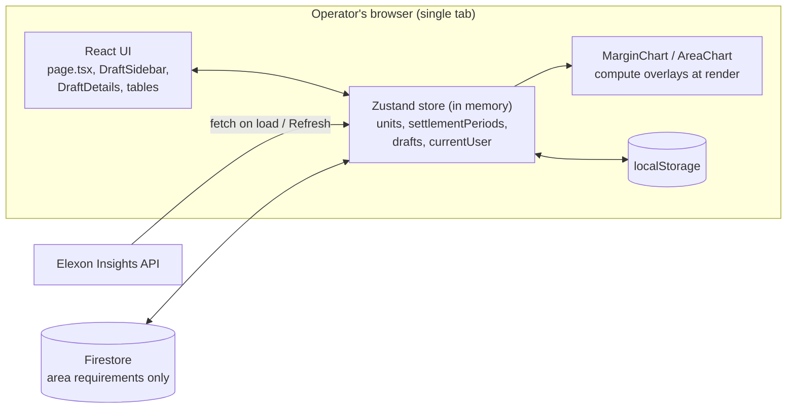
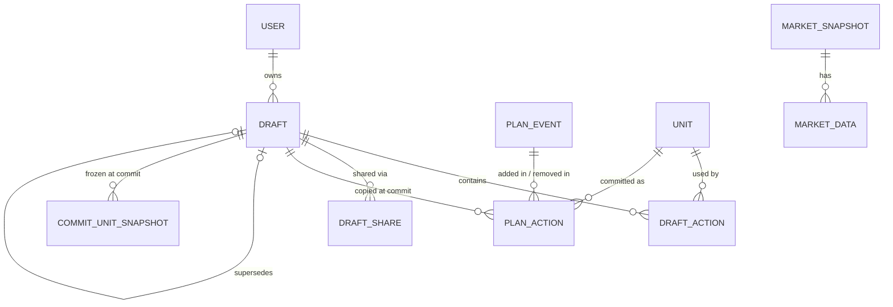
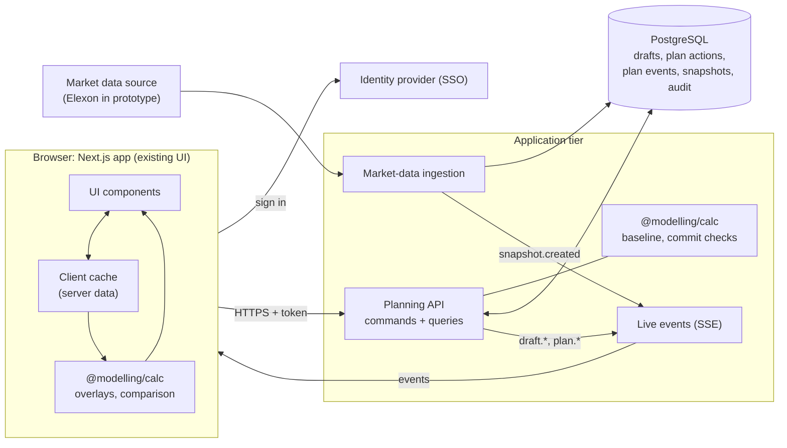
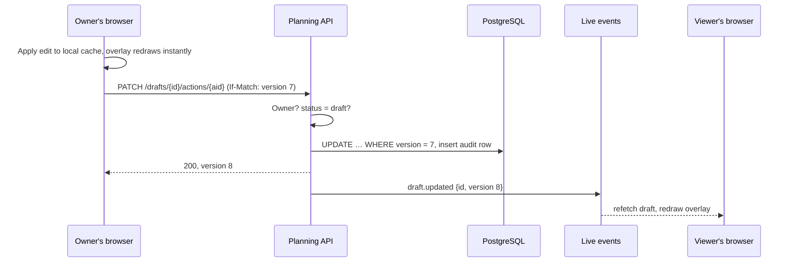

# Drafts: Current Implementation and Production Architecture

**Status:** the current state is described as of October 2026 (commit `5a9ef13`). The target architecture is a **proposal for discussion**. Decisions are tracked in §21, and each is marked adopted, proposed or open.
**Audience:** product owner and solution architect.
**Diagrams:** open [`drafts-architecture-diagrams.html`](drafts-architecture-diagrams.html) in a browser for a visual walkthrough.

**How to read this document**

| Part | What it covers | Read if you want to… |
|---|---|---|
| **Mental model** (next section) | Drafts explained as GitHub pull requests: what to borrow and what not | get the idea in two minutes |
| **A. Current implementation** (§1–4) | How the prototype does drafts, dotted lines, commit and sharing | understand what exists and what is worth keeping |
| **B1. Logical model and rules** (§5–12) | Platform-independent design: concepts, data model, lifecycle, the committed plan, calculation and comparison rules, permissions | agree *what* the system does |
| **B2. Reference implementation** (§13–19) | One way to build it (PostgreSQL, API, live events), with assumptions marked | discuss *how* to build it |
| **C. Delivery plan** (§20–22) | Phases, decisions, risks | plan the work |

---

# Mental model: drafts are like GitHub pull requests

If you know GitHub, you already know most of this design. The committed plan is `main`. A draft is a pull request against it. The dotted line is the PR's diff view. Committing is merging.

## The mapping

| GitHub | Our drafts | Notes |
|---|---|---|
| `main` branch | **Committed plan**: the solid baseline every operator sees | One shared plan (D3). Stored as a versioned log (§9.1) |
| Branch / pull request | **Draft**: a proposed change on top of the plan | Holds intent (units + times), not results |
| "Files changed" view | **Dotted line**: the plan as it would be if this draft went in | Computed live in the browser |
| Commits inside a PR | **Actions** inside a draft, one per unit | §2.1a |
| Merge | **Commit**: the draft's actions are added to the plan | One transaction (§16.3) |
| Follow-up PR that replaces a merged change | **Edit on a committed draft** = duplicate + **supersede**: the new version replaces the old in one step, with no gap | §8.3, D16, D20 |
| Revert commit | **Withdraw** (UI label may stay "Uncommit"): removes the draft's actions from an effective time onward. History is kept | §8.4, D17 |
| Closing a PR without merging | **Discard** an open draft (restorable) | |
| Fork | **Duplicate**: your own editable copy of any draft | |
| Reviewer / read access | **Share**: others can view and duplicate, not edit | |
| Merge conflict | **Clash**: same unit, overlapping half-hours. **Blocked**, so amend the existing commitment instead | D18 |
| Required review before merge | **Commit approval** | D4 |
| CI checks before merge | **Validation before commit**: clashes, effective-time warnings, drift since last edit, MNZT (if D14 = profiles) | §8.4, §11.3 |
| Cherry-pick | **Commit selected units** | D15 |
| HEAD commit id | **Plan version** (`plan_seq`) | Tells browsers their baseline is stale |
| `git log` / blame | **Plan history**: plan actions with the version they were added and removed in | §9.5 |

## Where the analogy breaks (and why the design differs)

1. **The base moves by itself.** `main` only changes when someone merges. Our baseline also changes every few minutes as new market data arrives. → Drafts store **intent**, not results, so they are re-applied to whatever the current baseline is. There is never a manual rebase.
2. **Drafts are usually competing alternatives.** Most PRs eventually get merged. Several drafts are often different answers to the same shortfall, and only one is committed. → Comparing options is a core feature (§11).
3. **Time runs out, and the past is fixed.** A PR can sit for months, and a revert undoes everything. A draft for 17:00 is worthless at 17:30, and half-hours already delivered can't be undone. → Real times, an **Expired** flag, and changes that apply only from an **effective time** (§8.4).
4. **Conflicts are about meaning, not lines.** Git compares text. We compare "same unit, same half-hour". → A rule enforced by the database, never a merge editor.
5. **Live, not pull-based.** Operators must see a colleague's commit within seconds. → Server-pushed live events (§17).
6. **Merging a draft doesn't change other drafts.** Other drafts' dotted lines redraw against the new baseline, and any unit now committed elsewhere stops counting (§10.3).

## Worth borrowing

| Idea from GitHub | What it means for us | Where it fits |
|---|---|---|
| **Protected `main`** | Only commit, supersede and withdraw can change the plan. Nothing writes to it directly | Built in (§9.1) |
| **Never rewrite history** | Plan actions are never edited or deleted. Changes close old rows and add new ones | Built in (§9.1) |
| **Follow-up PR instead of editing merged code** | Edit on a committed draft creates a new version that supersedes the old one atomically | Built in (§8.3) |
| **Checks before merge** | Clash, effective-time and drift checks are shown in the commit dialog before the operator confirms | Phase 4 |
| **Required review** | Optional senior approval before commit | D4 (Phase 6 if chosen) |
| **PR description** | The draft's description explains *why*. Consider making it mandatory at commit, and require a reason on supersede and withdraw | Phase 2 / 4 |
| **Review comments** | Recipients of a shared draft can comment ("why not PEHE-1?") | Phase 6 |
| **Notifications** | "OSM shared a draft with you", "the draft you are editing was changed by NSE" | Phase 3 |
| **History browsing** | "Show me the plan as it was at 14:00": a simple query over plan actions | Query in Phase 4, UI in Phase 6 |
| **Blame** | For any unit and half-hour: which draft put it there, who committed it, when, and what it replaced | Query in Phase 4, UI in Phase 6 |

## Not worth borrowing

| Git / GitHub feature | Why not |
|---|---|
| **Git itself as the storage engine** | We need queries, transactions, constraints, row-level security and live events. A relational database does all of this |
| **Branches of branches / stacked PRs** | A draft is always against the current plan. To build on a colleague's draft, duplicate it. To see two drafts together, use the read-only combined preview (§11.2) |
| **Text diffs and three-way merges** | Our "diff" is a calculated MW delta per half-hour, and our "conflict" is a rule. There is nothing to merge line by line |
| **Manual rebase** | The baseline moves constantly, so drafts must re-apply automatically |
| **Pull-based sync** | Operators need changes pushed to them in seconds |
| **Long-lived drafts** | Drafts expire with time |
| **Force-push / history rewrite** | Breaks the audit trail. Never allowed |
| **Merge commits that combine several drafts** | Each draft is committed on its own, which keeps "which option did we choose and why" clear |

---

# Part A: Current implementation

## 1. Short version

- A **draft** is a named list of "what if we bring these units on, for these settlement periods" decisions. It holds **no market data of its own**, only references to units and time slots.
- The app holds **one copy** of the market data (units and 48 settlement periods). It stores the **baseline** totals (EMX / EOL / EMI) once per settlement period.
- The dotted line for a draft is computed **when the chart draws**: *baseline + what this draft would add*. Nothing is precomputed or stored per draft.
- **Committing** a draft moves its units into the baseline, so the solid lines change.
- **Everything runs in the operator's browser.** No server, no database and no user accounts are involved in drafts. Drafts live in browser memory and **are lost on page reload, on Refresh, or when historical data is loaded**.
- **Sharing is simulated.** The seven operator identities (ANSE, NSE, OSM, OEM, NBE, TSM, TSE) are a drop-down in one browser. "Sharing" adds a name to a list on the draft, and you see the result by switching identity in the same tab.

### The user experience we achieved (to be kept)

| Capability | Prototype status |
|---|---|
| Create one or more drafts, each colour-coded | ✅ |
| Add and remove units, set per-unit time window, reason, event type, notes | ✅ |
| See each open draft as a **dotted line** on the Margin and area charts before committing | ✅ (Chart tab only) |
| Show or hide each draft's line from the sidebar | ✅ |
| Commit a draft so its units become part of the **solid baseline** everywhere | ✅ |
| Uncommit, discard, restore, delete, duplicate | ✅ |
| Share a draft with other operators: view-only, with "Duplicate to my drafts" | ✅ (simulated) |
| Preview an open draft's effect on the **Dashboard / Dashboard 2** tiles | ❌ Dashboards show the committed baseline only |

---

## 2. In plain English

### 2.1 What a draft is

An operator sees a shortfall in, for example, margin between 17:00 and 19:00. They want to try a few options before deciding. Each option is a **draft**: a working sheet that says *"bring on unit A and unit B from 17:00 to 19:00, for margin, as an Advanced Synch."*

A draft has a name, an optional description, a colour, a default time window, and a list of **actions**, one per unit. Each action records the unit, its start and end slot, the output level and the reason (Margin, Recovery Reserve, Inertia and so on).

### 2.1a One draft, many units (not one draft per unit)

A draft is a **container**. Each unit you add becomes one **action** (one row) inside it. A draft with five units is one draft with five actions, not five drafts.

```
Draft A  (owner NSE, default window 17:00–19:00)
 ├─ action: T_DRAXX-1   17:00–19:00   645 MW   Margin
 ├─ action: T_CNQPS-2   17:30–19:00   380 MW   Margin
 └─ action: T_PEHE-1    18:00–open    250 MW   Recovery Reserve

Draft B  (owner OSM)
 ├─ action: T_CNQPS-2   06:00–08:00   380 MW   Inertia     ← same unit as in Draft A: allowed
 └─ action: T_SHBA-1    06:00–09:00   400 MW   Response
```

(Unit names and figures are illustrative.)

Rules in the prototype:

- **A unit appears at most once in a draft.** Adding it again is ignored (`addUnitsToDraft` skips units already in the draft).
- **Each action has its own settings.** Window (From/To, editable per row in the Selected table; To can be left open), output level, **one** reason, event type and note. New actions copy the draft's default window. Changing the draft's From/To **resets every action's window** to match.
- **The same unit can be in several drafts**, including drafts owned by other operators. The Available table marks this with **●N** ("in N other drafts", names shown on hover). Each open draft's dotted line includes that unit independently.
- **Commit, discard, share and duplicate act on the whole draft**, never on one action.
- **If the same unit is committed in two drafts for the same half-hour, it is counted once, and the earliest-created draft's values win by accident** (`computeAggregates` keeps the first action it meets). The proposed design blocks this case (§9.2) and makes reason a list, so one commitment can serve several needs (§9.3).

### 2.2 The lifecycle

```
          ┌──────────── Uncommit ────────────┐
          ▼                                  │
  New → [ Draft ] ── Commit ──────────► [ Committed ]
          │  ▲                               │
  Discard │  │ Restore                       │ Discard
          ▼  │                               ▼
       [ Discarded ] ◄───────────────────────┘
          │
        Delete (gone for good)
```

- **Draft**: editable by its owner. It shows on the chart as a **dotted** line.
- **Committed**: read-only. Its units are now in the **solid** baseline on every chart, dashboard tile and cost card. Nothing is sent to a unit or a control system.
- **Discarded**: set aside. It does not count anywhere and can be restored or deleted.

The proposed lifecycle differs: committed drafts never become editable again. See §8.

### 2.3 Where the dotted line comes from

1. **The solid lines (the baseline).** For each half-hour, the app adds up every unit already running according to its Physical Notification (PN), plus every unit in a **committed** draft. This is worked out whenever data loads or the set of committed drafts changes, and stored against each settlement period.
2. **The dotted lines (each open draft).** When the chart draws, the app takes the stored baseline and adds the units in that draft that are not already counted.

Two rules:
- **No double counting.** A unit already running (PN above 1 MW) or already committed adds nothing for that half-hour.
- **The dotted line only appears where the draft changes something.** Elsewhere it is not drawn, so the solid line shows through. One anchor point on each side joins it to the solid line.

### 2.4 Why each draft doesn't need its own data set

A draft holds only unit IDs, time slots and a few settings. The heavy data (48 half-hours × hundreds of units) exists **once**. Drawing a draft needs only the stored baseline value plus the MEL / output / SEL of the few units in the draft. A draft is a **delta** on a shared baseline: ten drafts cost ten small lists, not ten copies of the market data.

### 2.5 How sharing works today

- Every draft has an **owner** and a **shared with** list. The owner manages the list using the share icon.
- After switching identity, the sidebar shows *your* drafts plus a **"Shared with me"** section.
- Shared drafts are **view-only**. The only action is **"Duplicate to my drafts"**.
- All of this happens inside one browser tab. Two operators on two PCs cannot see each other's drafts.

### 2.6 Where things are stored today

| What | Where | Survives reload? | Shared between machines? |
|---|---|---|---|
| Drafts (all statuses) | Browser memory (Zustand store) | **No** | **No** |
| Current identity | `localStorage['bm-current-user']` | Yes | No |
| Chart visibility of each draft | Browser memory (`page.tsx`) | No | No |
| Market data (units, PN, demand) | Browser memory, fetched by each browser from the public Elexon API | No (re-fetched) | No |
| Standing data cache (NDZ/MZT/MNZT/SEL) | `localStorage` | Yes | No |
| Area requirements | **Firestore** (`config/area_requirements`) | Yes | **Yes** (not draft data) |

---

## 3. Current architecture

### 3.1 Runtime topology



### 3.2 Data model (`src/models/types.ts`)

**`DraftPlan`**: `id`, `name`, `description`, `actions: ModellingAction[]`, `status: 'draft'|'committed'|'discarded'`, `color`, `fromPeriod`/`toPeriod` (default window, slot index 1–48), `unitNotes`, `createdAt`/`committedAt?`/`discardedAt?`, `ownerId`, `sharedWith: UserId[]`, `dataSnapshot?` (unit parameters frozen at commit).

**`ModellingAction`**: `bmUnitId`, `fromPeriod`, `toPeriod | undefined` (undefined = open-ended), `outputLevel` (MW, defaults to SEL → registered capacity → 100), `reasonCode` (one of 8 values), `operationType?`, `timestamp`.

**`SettlementPeriodData`** (48 rows, the shared data set): `settlementPeriod` (**slot index in the rolling window, not the real SP**), `settlementDate`, `startTime`, `pn`/`mel`/`mil` per unit, `demand`, baseline `emx`/`eol`/`emi`/`margin`, `areaAvailability`, `hasConfirmedPn`, `proxyEmx`/`proxyEol`.

**`UnitSnapshot`**: `mel, sel, ndz, mzt, mnzt, priceToSel, priceToMel`.

### 3.3 Store operations (`src/store/useModellingStore.ts`)

| Method | Effect | Recomputes baseline? |
|---|---|---|
| `createDraft` | New draft owned by `currentUser` | No |
| `addUnitsToDraft` / `removeUnitFromDraft` | Add or remove actions | Remove: only if committed |
| `updateDraftWindow` | Sets window **and overwrites every action's window** | Only if committed |
| `updateUnitWindow`, `updateUnitReason`, `updateUnitOperationType`, `updateUnitNotes`, `renameDraft`, `updateDraftDescription` | Field edits | Window only, if committed |
| `commitDraft` | Snapshot + `status='committed'` | **Yes** |
| `discardDraft` / `reopenDraft` | Status change | If it was committed |
| `deleteDraft` | Remove | No |
| `duplicateDraft` | Copy owned by `currentUser`, `sharedWith=[]` | No |
| `shareDraft` / `unshareDraft` | Edit `sharedWith` | No |
| `setCurrentUser` | Switch identity | No |
| `clearAllDrafts` | Wipe; called on every data load | If any were committed |

"Recomputes baseline" means calling `refreshAllAggregates`, which runs `computeAggregates` for every SP and then `computeAreaAvailabilities`.

### 3.4 The calculation: baseline + delta

**Baseline (stored)**, `computeAggregates` in `src/utils/margin.ts`:

```
for each unit in sp.pn with PN > 1 MW:
    EMX += sp.mel[unit] ?? PN;  EOL += PN;  EMI += SEL ?? MIL ?? 0
for each action in COMMITTED drafts covering this SP (once per unit):
    if unit PN ≤ 1 MW:
        EMX += sp.mel[unit] ?? 0;  EOL += outputLevel;  EMI += SEL ?? MIL ?? 0
```

**Draft overlay (computed at render)**, `applyDraftToBaseline` in `margin.ts`, called from `MarginChart.tsx`:

```
alreadyModelled = PN-running units ∪ committed units covering this SP
draft.EMX = sp.emx + Σ MEL of draft units covering this SP and not in alreadyModelled
(same for EOL and EMI)
draft margin = draft.EMX − TR2      (TR2 = demand × (1 + reserve%) + General Reserve requirement)
```

Non-margin areas use `applyDraftToAreaBaseline` in `src/utils/areaAggregates.ts` with per-area rules from `unitAreaContribution`. Area availability counts every committed unit's physical contribution to every area, whatever its reason code.

**Partial line.** Each draft is drawn as Recharts series `draft_<id>_emx|eol|emi`. A covered slot gets the overlay value, a neighbouring slot gets the baseline value (the anchor point), and every other slot gets `null` (not drawn).

### 3.5 Sharing and permissions (UI-only)

| Who | Sidebar | Edit / commit / discard / share | Duplicate |
|---|---|---|---|
| Owner | Editing / Committed / Discarded | Yes (edit only while `draft`) | Yes |
| In `sharedWith` | "Shared with me" | No | Yes |
| Others | Not listed | No | No |

---

## 4. Known limitations of the prototype

1. **No persistence.** A reload, **Refresh** or **Load historical data** wipes all drafts.
2. **Drafts reference slot indices, not absolute times.** After a refresh the window moves, so index 10 means a different half-hour. This is the main blocker for persistence.
3. **Sharing is simulated.** There is one tab, one memory space, and no authentication or transport.
4. **Permissions are UI-only.** Store methods don't check `ownerId`.
5. **The charts show every identity's open drafts,** not only yours and those shared with you (`MarginChart` / `AreaChart` filter only on status and visibility). The Available table's "in N other drafts" indicator also counts all identities' drafts.
6. **The baseline is global.** Any identity's commit changes everyone's solid lines. This is probably intended, but it is not stated anywhere.
7. **Non-margin overlay dedup is too broad.** `AreaChart` treats a unit as "already counted" if it is committed **anywhere in the window**. `MarginChart` checks **per SP**.
8. **Changing a draft's window resets per-unit windows.**
9. **No draft preview on the dashboards.** Tiles reflect committed data only.
10. **Each browser fetches its own market data,** so two operators can see slightly different baselines.
11. **The same unit committed twice: the first draft wins silently** (see §2.1a).
12. **Uncommit erases the past.** Uncommitting removes the whole draft from the baseline, including half-hours already delivered, and changing a committed draft means uncommit → edit → recommit, with a gap in between.

**What carries over to production:** the calculation model (§3.4), the draft and action structure (§3.2) and the UI. **What changes:** storage, identity, sharing transport, permission enforcement, and how the committed plan is stored and amended.

---

# Part B1: Logical model and rules

This part is **platform-independent**. It describes what the system does and the rules it enforces, whatever it is built with. Part B2 describes one way to build it.

## 5. Goals and requirements

### 5.1 Functional parity: same user experience

| # | Requirement |
|---|---|
| F1 | An operator can create, rename, describe, duplicate, discard, restore and delete their own **open** drafts |
| F2 | An operator can add and remove units in a draft, set each unit's window (open-ended allowed), output, **one or more reasons**, event type and notes |
| F3 | Each open draft the operator can see is drawn as a dotted overlay on the Margin and area charts, updating **instantly** as they edit |
| F4 | The operator can show or hide each overlay |
| F5 | Committing a draft adds its units to the **shared committed plan**. Every operator's solid lines update |
| F6 | A committed draft can be **edited** (the familiar flow), which creates a new version that replaces it without a gap, or **withdrawn**. Both apply from an effective time and never change the past |
| F7 | The owner can share a draft with named operators or a desk. Recipients see it read-only and can duplicate it |
| F8 | Committed-data drift indicators (↑/↓ against the commit snapshot) continue to work |
| F9 *(optional)* | Preview a selected draft's effect on Dashboard / Dashboard 2 tiles |
| F10 *(new)* | Compare options side by side across all areas (§11.1) |
| F11 *(new)* | Preview two or more open drafts combined, read-only (§11.2) |

### 5.2 Production requirements

| # | Requirement |
|---|---|
| N1 | **Persistence.** Drafts survive reloads, refreshes, restarts and new market data |
| N2 | **Real multi-user.** Operators on different machines see shared drafts and commits within seconds |
| N3 | **Identity.** Single sign-on. No self-selected identity |
| N4 | **Authorisation enforced server-side** |
| N5 | **Consistency.** All operators compute the baseline from the same market data and the same committed plan version |
| N6 | **Audit and history.** Every command is recorded. The committed plan at any past version can be reconstructed exactly |
| N7 | **Concurrency safety.** Commits and edits never silently overwrite each other. Two commitments for the same unit and half-hour can never both exist |
| N8 | **Time correctness.** Actions refer to real half-hours (UTC), including clock-change days (46/50 SPs). The past is never changed |
| N9 | **Availability** suitable for a control-room tool (target to be agreed, D12) |

---

## 6. Core concepts and invariants

### 6.1 Glossary

| Term | Meaning |
|---|---|
| **Draft** | An editable container of proposed actions, owned by one operator. Stores intent, never results |
| **Action** | One unit inside a draft: window, output, reasons, event type, note |
| **Committed plan** | The set of **plan actions** currently in force. One plan for everyone (D3) |
| **Plan action** | An immutable copy of an action, made when a draft is committed. Carries the plan version it was **added in** and, once closed, the version it was **removed in** |
| **Plan version** (`plan_seq`) | A counter incremented by every change to the plan (commit, supersede, withdraw) |
| **Supersede** | Atomically replace a committed draft's future plan actions with those of a new draft (the "Edit" flow) |
| **Withdraw** | Close a committed draft's plan actions from an effective time onward (the prototype's "Uncommit") |
| **Effective time** | The half-hour boundary from which a supersede or withdraw (or a new commit) takes effect. Never in the past |
| **Market snapshot** | An immutable copy of the market data at a point in time. The baseline is computed from (snapshot, plan version) |
| **Baseline** | Per half-hour totals: units already running plus the committed plan |
| **Overlay** | Baseline + one draft's delta: the dotted line |

### 6.2 Principles

1. **Drafts are intent, not results.** They are re-applied to whatever the current baseline is, and nothing is stored per draft.
2. **The committed plan is a versioned log, not mutable state.** It changes only by adding plan actions or closing them, never by editing them.
3. **Baseline + delta.** The baseline is computed once per (snapshot, plan version). Each draft is a delta on top of it.
4. **Absolute time.** Every action uses UTC half-hour boundaries. Slot indices exist only on screen.
5. **Commands, not raw writes.** Intent-level commands (commit, supersede, withdraw, share) are validated and applied atomically, with an audit record and an event.
6. **One calculation library** used everywhere the numbers are computed.

### 6.3 Invariants (always true)

| # | Invariant |
|---|---|
| I1 | The committed plan at version N is exactly the plan actions with `added_in ≤ N` and (`removed_in` empty or `removed_in > N`) |
| I2 | A plan action is never edited. The only change ever made to it is setting `removed_in`, once |
| I3 | At any plan version, **no two plan actions for the same unit overlap in time** (D18) |
| I4 | A committed draft's contents never change. It moves only to *superseded* or *withdrawn* |
| I5 | No command changes a half-hour that has already started: effective times are never in the past (D17) |
| I6 | A unit appears at most once in a draft |
| I7 | Every action has at least one reason |

---

## 7. Logical data model



| Entity | Key attributes | Notes |
|---|---|---|
| **User** | identity, role, desk | From SSO |
| **Draft** | owner, name, description, colour, status, default window, context (live / historical), `supersedes` (link to a committed draft, set by the Edit flow), version (for concurrency), last-evaluated impact (for the drift check, §11.3) | Status: `draft`, `committed`, `superseded`, `withdrawn`, `discarded` |
| **Draft action** | unit, start, end (empty = open-ended), output, **reasons (list, ≥ 1)**, event type, note | Unique per (draft, unit) |
| **Draft share** | draft, grantee (user **or** desk), permission (view) | Desk shares follow desk membership: whoever is on the desk now has access |
| **Plan action** | source draft and action, unit, start, end, output, reasons, event type, `added_in`, `removed_in`, `split_from` | Immutable (I2). See §9 |
| **Plan event** | plan version, time, actor, type (`commit`, `supersede`, `withdraw`), draft, replaced draft, effective time, reason, acknowledged warnings | Append-only. One per plan change |
| **Commit unit snapshot** | draft, unit, MEL, SEL, NDZ, MZT, MNZT, prices | Unit data frozen at commit. Drives ↑/↓ drift arrows and indicative cost |
| **Market snapshot** | time taken, kind, per half-hour demand, per unit PN / MEL / MIL | Immutable |
| **Audit event** | actor, time, entity, command, before, after | Append-only |
| *Optional (D14)* **Action profile** | action, half-hour, MW, source (generated / override) | Only if unit profiles are chosen. Copied to the plan on commit |
| *Optional (D19)* **Delivery status** | plan action → committed / instructed / delivered / lapsed, or a link to instruction records | Room left in the model, not built in the first release |

**Time model.** Starts and ends are UTC half-hour boundaries, and the end is exclusive. They are displayed as Europe/London settlement date + SP (tested rules exist in `src/dashboard2/time.ts`, including 46/50-SP days). An action whose end has passed is **expired**. It is excluded from **forward-looking** views (overlays, comparison, commit checks) but **kept in history views and the plan record**.

---

## 8. Lifecycle and commands

### 8.1 States

```
                    Commit
  New → [ Draft ] ─────────────► [ Committed ] ──── Withdraw (from effective time) ──► [ Withdrawn ]
          │  ▲                       │
  Discard │  │ Restore               │ Edit = duplicate → change → commit as "supersede"
          ▼  │                       ▼
     [ Discarded ]            [ Superseded ]  ◄── replaced atomically by the new version
          │
        Delete
```

- **Draft**: editable by the owner. Dotted line.
- **Committed**: its actions are in the plan. Read-only, and **never returns to Draft** (I4).
- **Superseded**: replaced by a newer version from the effective time onward. Its earlier half-hours stay in the plan record.
- **Withdrawn**: removed from the plan from the effective time onward. Its earlier half-hours stay in the plan record.
- **Discarded**: an open draft set aside. Restorable. Can be deleted.
- Superseded and withdrawn drafts are read-only, but anyone who can see them can **duplicate** them.
- **Expired** is a display flag on any draft whose actions are all in the past.

### 8.2 Commands

| Command | Applies to | Effect on the plan |
|---|---|---|
| Create, edit actions, rename, describe | Open draft (owner) | None |
| Share / unshare | Any draft (owner) | None |
| Duplicate | Any visible draft | None. New open draft owned by the caller |
| Discard / restore / delete | Open draft (owner) | None |
| **Commit** | Open draft | Adds plan actions from the effective time (§8.4). New plan version |
| **Edit** (UI) | Committed draft | Creates an open draft with `supersedes` set. Nothing changes until it is committed |
| **Commit as supersede** | Open draft with `supersedes` | One transaction: closes the old draft's plan actions from the effective time and adds the new ones. One new plan version. Old draft → Superseded |
| **Withdraw** | Committed draft | Closes its plan actions from the effective time. New plan version. Draft → Withdrawn |
| **Commit selected units** (D15) | Open draft | Creates a copy containing only the selected units, commits it, and removes those units from the original, which stays open. One transaction |

### 8.3 Editing a committed draft (D16, D20)

Operators keep a familiar **Edit** button on committed drafts. Behind it:

1. **Edit** creates an open copy of the committed draft, owned by the caller, named "Draft A (v2)", with `supersedes = A`. The UI shows a banner: *"Editing committed plan Draft A. Changes take effect when you commit, from [effective time]."*
2. **While editing, Draft A stays in the plan.** Nobody sees a gap or a false shortfall.
3. The dotted line for v2 shows **the plan with A replaced by v2**, not "A plus v2" (§10.2).
4. **Commit** (labelled "Commit changes") performs the supersede. **Cancel** discards v2, and A is untouched.
5. If someone else supersedes or withdraws A while v2 is being edited, committing v2 fails with a clear message. The operator can then re-base by editing the new version.

Committed drafts therefore stay immutable while the operator flow stays familiar. **This user-experience choice is recorded as D20 for operator sign-off.** It does not block the build.

### 8.4 Effective-time rules (D17)

Every command that changes the plan (commit, supersede, withdraw) takes effect from an **effective time**: a half-hour boundary.

| Rule | Type | Detail |
|---|---|---|
| **Never in the past** | **Hard**: rejected | The effective time must be ≥ now. The earliest allowed value is therefore the **start of the next half-hour**, because the current one has already started. Default = earliest allowed. The operator may choose a later boundary |
| **Within gate closure** | Warning: acknowledge to continue | Effective time earlier than gate closure for that half-hour (≈ 1 hour before delivery) |
| **Within unit notice time** | Warning: acknowledge to continue | For units being added or extended: effective time earlier than now + the unit's NDZ (notice to deviate from zero) |
| *Minimum run / off time* (if D14 = profiles) | Warning | Window shorter than MNZT, or a gap shorter than MZT |

Acknowledged warnings are stored on the plan event and in the audit trail.

How the effective time applies:
- **Commit:** action parts before the effective time are clipped off. An action entirely before it can't be committed (it has expired).
- **Supersede / withdraw:** plan actions entirely before the effective time are untouched. Actions entirely after it are closed. An action spanning it is **split**: the original is closed, and a new plan action covering start → effective time is added (`split_from` links them). The past stays in the plan exactly as it was.

### 8.5 Historical mode

Drafts created against a historical snapshot carry `context = historical`. They behave like live drafts for modelling and comparison, but **can never change the live plan**. Whether they can be committed to a per-user sandbox plan is D10.

---

## 9. The committed plan

### 9.1 A versioned log of plan actions

On commit, each draft action is **copied** into the plan as a plan action, stamped with the new plan version (`added_in`). The draft keeps its own copy for display, but the plan actions are the record.

- **Current plan** = plan actions not yet closed.
- **Plan at version N** (or at 14:00) = invariant I1. It's a query, not a reconstruction.
- **Changing the plan** only ever closes plan actions (sets `removed_in`) and adds new ones, in one transaction per plan version.

This makes history browsing and blame simple queries, and means the committed record can never drift from what was actually committed.

### 9.2 One commitment per unit per half-hour (D18)

**A unit can have only one open plan action at any moment** (invariant I3). A commit that would overlap an existing commitment for the same unit is **rejected**, and the message names the clashing draft and owner.

- To change a unit's commitment, **edit the draft that holds it** (supersede, §8.3). Supersede closes the old plan actions before adding the new ones, so it never clashes with itself.
- This removes the "which value wins?" ambiguity in the prototype (§2.1a) instead of resolving it with a rule.
- It replaces D5: there is no "warn and acknowledge" for clashes.

### 9.3 Reasons are a list

**One unit, one commitment, many reasons.** Each action carries a list of reasons (at least one), e.g. `[Margin, Inertia]`. Together with §9.2, if two operators need the same unit for different purposes, the second **edits the existing commitment to add their reason** instead of committing a duplicate.

| Where reasons are used | Rule |
|---|---|
| Area availability (calculation) | **Not affected.** A committed unit contributes physically to every area, whatever its reasons (as today) |
| Committed tab cost cards, per-reason breakdowns | A unit appears under **each** of its reasons. **Totals count it once.** Per-reason figures can therefore add up to more than the total, and the UI says so |
| Dashboard tile alerts filtered by reason | A unit matches if the reason is in its list |
| Migration from the prototype | `reasonCode` becomes `[reasonCode]` |

### 9.4 Supersede and withdraw in one picture

```
Plan version N:    A  DRAXX-1  15:00 ─────────────────────── 19:00
Edit A → A′ (trim to 18:00), effective 16:30, committed at 16:10:
Plan version N+1:  A  DRAXX-1  15:00 ──── 16:30                       (split: past kept, rest closed)
                   A′ DRAXX-1             16:30 ──── 18:00            (added in the same version)
```

Without supersede, the old flow (uncommit, edit, recommit) produced a version with nothing committed, which every screen showed as a shortfall, and it also erased 15:00–16:30.

### 9.5 History and blame

- **Plan at time T:** find the plan version current at T, then apply I1.
- **Blame (unit, half-hour):** the plan action covering it, plus its draft, the plan event that added it (who, when, reason), and what it replaced (`supersedes`, `split_from`).
- **Draft lineage:** follow `supersedes` links: A → A′ → A″.

### 9.6 Room for instruction and delivery (D19)

Committing does not instruct a unit. A production tool will eventually need to know whether a plan action was **instructed** and whether it **delivered**, to reconcile plan with reality. The model leaves room for this with an optional delivery status on plan actions (committed / instructed / delivered / lapsed) or a link to instruction records. It is not built in the first release.

---

## 10. Calculation rules

### 10.1 Baseline + delta

- **Baseline** for (snapshot, plan version): units already running (PN > 1 MW) plus open plan actions, **once per unit per half-hour**.
- **Overlay** for a draft: baseline + that draft's units that aren't already counted in that half-hour.
- **One contribution function** answers "what does this action add in this half-hour?" for every area. Today it returns a flat block. It is the switch point for D14 (§10.4).

### 10.2 Rules

- **No double counting per half-hour**, for margin and all areas (fixes prototype limitation 7).
- **Superseding drafts are drawn as replacements.** For a draft with `supersedes = A`, the overlay is *baseline − A's contribution (from the effective time) + this draft's contribution*. The calculation library computes A's contribution with the same function and subtracts it.
- **Visibility:** draw only drafts the user owns or that are shared with them, minus any they have hidden (fixes limitation 5). The ●N indicator follows the same rule.
- **Expired actions** are excluded from forward-looking views and kept in history views (§7).
- **Open-ended actions** run to the end of the displayed horizon.
- **Partial line with anchor points:** unchanged.

### 10.3 The moving baseline

When the baseline changes (new snapshot, or someone else changes the plan), every overlay is recomputed. Nothing is stored per draft, so nothing needs migrating. If a unit in my draft is now committed by someone else, my overlay stops counting it, and the UI flags it ("already committed in OSM's draft, 14:32; edit that draft to change it").

### 10.4 Open decision D14: how each unit's contribution is modelled

**Already settled:** a draft's impact is the **sum of its units' contributions** per half-hour. Lifecycle, sharing, the plan model and the API are the same for both options.

**Open:** the *shape* of each unit's contribution over time.

#### Option A: flat block (what the prototype does)

Each action has a start, an end and one output level. For every half-hour from start to end, the unit adds the same amount: EMX += MEL, EOL += output, EMI += SEL.

```
MW │    ┌───────────┐
   │    │           │
   └────┴───────────┴────
       start       end
```

#### Option B: unit profile

Each action has a start, an end **and a MW value per half-hour**, generated from the unit's data (NDZ, SEL, MEL, run-up / run-down rates, MNZT / MZT) and editable by the operator for individual half-hours. The draft impact is the sum of the profiles.

```
MW │            ┌────┐
   │          ╱      ╲
   │        ╱          ╲
   └──┬───┴──────────────┴──
    start notice ramp  hold  ramp down
```

#### Comparison

| | Option A: flat block | Option B: unit profile |
|---|---|---|
| Realism | Overstates contribution in the first half-hours. Ignores notice time and ramping | Contribution follows notice, ramp-up, hold and ramp-down |
| MNZT / MZT | Not checked | Warnings (§8.4) |
| Per-unit breakdown on the chart | Possible, but every unit is a rectangle | Meaningful ("of +1,200 MW at 18:30, DRAXX-1 gives 645") |
| Clash rule (D18) | By overlapping windows | Same rule. Windows still define the commitment |
| Operator effort | Pick units and a window | Same by default. Optional per-half-hour edits |
| Data needed | What we already have | Plus run-up / run-down rates: **not fetched today**, availability to be confirmed |
| Rules needed | None | Agreed ramp and notice rules, plus a definition of the EMX / headroom a ramping unit contributes |
| Build effort | Lowest | Profile generator, profile editor, more tests |
| Storage | Output on the action | Plus a profile per action, copied to the plan on commit |

#### Questions to answer before choosing

1. Do operators need notice and ramp realism in a planning tool, or is "on from start to end" an accepted simplification?
2. Are run-up / run-down rates available for the units we care about?
3. If a unit is ramping, does it count towards EMX from the start of the ramp, or only once at full output?
4. Should operators be able to edit a generated profile, and should that be audited separately?

#### Keeping the decision open (no regret)

A flat block is a profile with the same value in every half-hour. With the single contribution function (§10.1) in place from Phase 1, choosing Option B later means changing that function, adding profile storage and building the editor. Nothing else changes.

---

## 11. Comparing options

The main reason for having several drafts is choosing between them. Dotted lines show one area at a time, so they aren't enough on their own.

### 11.1 Comparison table

Select two or more drafts and open **Compare**. Drafts are columns, with the current plan as the first column.

| Row | Content |
|---|---|
| Per area (Margin, each reserve, Response, Inertia, Voltage) | Worst headroom over the horizon, and how it changes vs the current plan. Red if still short |
| Half-hours still short | Count across all areas |
| Units / MW added | Counted once per unit |
| Indicative cost | From unit price data. **Labelled indicative**: prices are placeholders until real offer data is integrated |
| Would clash | Units already committed elsewhere, so this draft would be rejected as it stands (D18) |
| Warnings | Gate closure / notice warnings at the default effective time |
| For an Edit (supersede) draft | Shown as a change against the version it replaces |

It is computed in the browser from the same overlays, so it is cheap.

### 11.2 Combined preview (read-only)

Select two or more open drafts and choose **Preview together**. You get one extra overlay, "A + B", plus a column in the comparison table.

- It is **read-only and never stored**. It does not create a draft, so the "no drafts built on drafts" rule still holds.
- A unit that appears in both drafts is counted once. If its settings differ, the preview flags it and uses the first-selected draft's version, because committing both as they stand would be rejected (D18).

### 11.3 The moving baseline while comparing

- **Drift check at commit:** each draft records the impact it had when last edited (snapshot, plan version, per-area worst headroom). The commit dialog recomputes against the latest data and flags a **material change**, e.g. an area's status changes or headroom moves by more than a configurable threshold.
- **Pin a snapshot (optional):** freeze the display on one market snapshot while weighing options, with a banner saying so. Commit always validates against the latest data and shows any drift.

### 11.4 Dashboard preview (F9, optional)

A "Preview: [draft ▼]" control applies one draft's delta (or a combined preview) to the Dashboard tiles. Decision D13.

---

## 12. Roles and permissions

| Action | Owner | Shared with (view) | Other operator | Senior operator | Viewer | Admin |
|---|---|---|---|---|---|---|
| See draft & overlay | ✅ | ✅ | ❌ | ❌ ¹ | ❌ | ✅ |
| Edit open draft | ✅ | ❌ | ❌ | ❌ | ❌ | ❌ |
| Share / unshare | ✅ | ❌ | ❌ | ❌ | ❌ | ❌ |
| Duplicate, compare, preview together | ✅ | ✅ | ❌ | ❌ | ❌ | ✅ |
| Commit | ✅ ² | ❌ | ❌ | ❌ | ❌ | ❌ |
| Edit (supersede) a committed draft | ✅ | ❌ | ❌ | ✅ ³ | ❌ | ✅ |
| Withdraw a committed draft | ✅ | ❌ | ❌ | ✅ ³ | ❌ | ✅ |
| See the committed plan, its history and blame | ✅ | ✅ | ✅ | ✅ | ✅ | ✅ |
| Discard / restore / delete open draft | ✅ | ❌ | ❌ | ❌ | ❌ | ✅ |

¹ Option: senior operators see all open drafts (D7).
² Option: commit requires senior approval (D4).
³ Covers the case where the owner has gone off shift (D6). A reason is mandatory.

Committed drafts are visible to everyone who can see the plan, because their units are in it.

---

# Part B2: Reference implementation

This part describes **one way** to build Part B1, based on the prototype's stack. It will be shaped by organisational standards, existing platforms and internal data feeds.

## 13. Assumptions

| Area | Assumption in this document | Likely in a real system |
|---|---|---|
| Market data source | Public Elexon Insights API (as in the prototype) | **Internal operational data feeds.** The public API is a prototype convenience |
| Database | PostgreSQL | Organisation's standard relational database. The no-overlap rule (I3) needs equivalent support |
| Live updates | Server-Sent Events | Organisation's messaging / push standard |
| Front end | Existing Next.js app | Likely kept |
| Hosting | Not specified | Organisation's platform |
| Identity | OIDC SSO (e.g. Entra ID) | Organisation's identity provider |

## 14. Components

### 14.1 Component diagram



### 14.2 Components

| Component | Responsibility |
|---|---|
| **Web client** | Existing UI. A client cache of server state. Computes overlays, the comparison table and the combined preview locally. Edits are applied optimistically and confirmed by the server |
| **Planning API** | Commands (draft edits, share, commit, supersede, withdraw), queries (drafts, plan, history, blame, baseline). Enforces permissions, invariants and effective-time rules. Writes audit records. Publishes events |
| **Live events** | Pushes events to connected clients. SSE is enough because all writes go through the API |
| **Market-data ingestion** | Pulls market data on a schedule (e.g. every 5 minutes) and writes immutable snapshots |
| **`@modelling/calc`** | Pure functions: contribution, baseline, overlay (including supersede replacement), comparison, status, time helpers. Golden-tested |
| **PostgreSQL** | System of record. Enforces I3 with an exclusion constraint |
| **Identity provider** | SSO, user id, role and desk claims |

### 14.3 PostgreSQL or Firestore (D1)

| Criterion | PostgreSQL + API | Firestore + security rules |
|---|---|---|
| Time to first version | Medium | **Fast** |
| **Enforce "no overlapping commitments" (I3)** | **Native**: exclusion constraint, race-free | Not native. Needs per-unit lock documents and careful transactions |
| Atomic supersede across many rows | One SQL transaction | Possible, with document-count limits |
| History / blame queries | SQL over plan actions | Needs denormalisation or export |
| Permission enforcement | API + row-level security | Security rules |
| Live updates | Needs an SSE layer | **Built in** |

**Recommendation:** PostgreSQL + API. The revised plan model (§9) leans heavily on constraints and multi-row transactions, which strengthens this choice. Firestore remains possible for a throwaway pilot.

---

## 15. Physical schema

**`users`**: `id`, `idp_subject` (unique), `display_name`, `email`, `role` (`viewer | operator | senior_operator | admin`), `desk`.

**`drafts`**

| Column | Type | Notes |
|---|---|---|
| `id` | uuid PK | |
| `name`, `description` | text | Description may be required at commit |
| `color` | text | |
| `status` | enum `draft \| committed \| superseded \| withdrawn \| discarded` | |
| `owner_id` | uuid FK users | |
| `context`, `historical_snapshot_id` | enum `live \| historical`, uuid null | §8.5 |
| `window_start`, `window_end` | timestamptz | Default window for new actions |
| `source_draft_id` | uuid null | Duplicate lineage |
| `supersedes_draft_id` | uuid null | Set by the Edit flow. Commit performs a supersede |
| `superseded_by_draft_id` | uuid null | Set when this draft is superseded |
| `version` | int | Optimistic concurrency. Every write, including bulk action edits, carries `If-Match` |
| `committed_at`, `committed_by`, `commit_plan_seq`, `commit_snapshot_id` | null | |
| `closed_at`, `closed_by`, `closed_plan_seq`, `close_reason` | null | Supersede or withdraw |
| `discarded_at`, `discarded_by` | null | |
| `last_evaluated` | jsonb null | Snapshot id, plan seq, per-area worst headroom at last edit (drift check) |
| `created_at`, `updated_at` | timestamptz | |

**`draft_actions`**: `id`, `draft_id`, `bm_unit_id`, `start_at`, `end_at` (null = open-ended, exclusive), `output_mw`, `reasons` (`reason_code[]`, `CHECK (cardinality(reasons) >= 1)`), `operation_type`, `note`, `created_at`, `created_by`. `UNIQUE (draft_id, bm_unit_id)`.

**`plan_actions`** (the committed plan)

| Column | Type | Notes |
|---|---|---|
| `id` | uuid PK | |
| `draft_id`, `draft_action_id` | uuid FK | Source |
| `bm_unit_id` | text | |
| `start_at`, `end_at` | timestamptz, end null = open-ended | Clipped to the effective time |
| `output_mw`, `reasons`, `operation_type` | | Copied from the action |
| `added_in_seq` | bigint FK plan_events | |
| `removed_in_seq` | bigint null FK plan_events | Set once, when closed |
| `split_from_id` | uuid null | Retained past part of a split row |
| `delivery_status` | enum null | Reserved for D19 |

Constraints:
- **No overlap (I3):** `EXCLUDE USING gist (bm_unit_id WITH =, tstzrange(start_at, end_at, '[)') WITH &&) WHERE (removed_in_seq IS NULL)` (requires the `btree_gist` extension). This makes the clash check race-free: two simultaneous commits for the same unit can't both succeed.
- **Immutability (I2):** no UPDATE grant except through a function that sets `removed_in_seq` from null. No DELETE grant.

**`plan_events`**: `seq` (bigserial = plan version), `at`, `actor_id`, `type` (`commit | supersede | withdraw`), `draft_id`, `replaced_draft_id`, `effective_at`, `reason`, `acknowledged_warnings` (jsonb). Append-only.

**`commit_unit_snapshots`**: `draft_id`, `bm_unit_id`, `mel`, `sel`, `ndz`, `mzt`, `mnzt`, `price_to_sel`, `price_to_mel`.

**`draft_shares`**: `draft_id`, `grantee_user_id` *or* `grantee_desk`, `permission`, `granted_by`, `granted_at`. Desk access is resolved at read time from current desk membership.

**`market_snapshots`**, **`market_sp`**, **`market_unit_sp`**, **`bm_units`**: as before. Immutable snapshots, with retention for the latest N plus any referenced by a commit.

**`audit_events`**: `id`, `at`, `actor_id`, `entity_type`, `entity_id`, `action`, `before`, `after`, `request_id`. Append-only.

Optional, only if chosen: **`draft_action_profiles`** / **`plan_action_profiles`** (D14). **`plan_action_instructions`** (D19).

**Related global data** (`unit_redeclarations`, `unit_services`, `area_requirements`) moves here with the same audit treatment (scope: D9).

---

## 16. Key workflows

### 16.1 Edit an open draft



A version mismatch returns 409. The client reloads and shows a notice.

### 16.2 Share a draft

`POST /drafts/{id}/shares {userId | desk}` (owner only). Writes audit and emits `draft.shared` to the grantees. Unshare emits `draft.unshared`.

### 16.3 Commit (including commit as supersede)

```mermaid
sequenceDiagram
  participant U as Owner's browser
  participant A as Planning API
  participant D as PostgreSQL
  participant R as Live events
  participant All as All browsers
  U->>A: POST /drafts/{id}/commit {effectiveAt?, acknowledgeWarnings?, reason?} If-Match
  A->>D: BEGIN; lock draft (and the draft it supersedes) FOR UPDATE
  A->>A: Rights, status = draft, context = live. If supersede: old draft still committed?
  A->>A: Effective time ≥ next half-hour? (hard: else 422)
  A->>A: Gate-closure / notice warnings
  alt warnings not acknowledged
    A-->>U: 409 {warnings} → confirm dialog
  else
    A->>D: If supersede: close old plan actions from effective time (split spanning rows)
    A->>D: Insert plan actions clipped to effective time (no-overlap constraint)
    alt overlap with another commitment
      D-->>A: exclusion violation → ROLLBACK
      A-->>U: 409 {clashes: unit, draft, owner} "edit that draft instead"
    else
      A->>D: Snapshots, plan_event (seq N+1), statuses, audit; COMMIT
      A->>A: Recompute baseline (snapshot, N+1)
      A-->>U: 200
      A->>R: plan.committed / plan.superseded {seq N+1}
      R-->>All: refetch baseline, solid lines update
    end
  end
```

### 16.4 Edit a committed draft

`POST /drafts/{id}/edit` creates the superseding draft (§8.3) and returns it. The operator edits it like any draft. Committing it runs §16.3 as a supersede. Cancelling discards it.

### 16.5 Withdraw

`POST /drafts/{id}/withdraw {effectiveAt?, reason, acknowledgeWarnings?}`. Same transaction pattern as supersede, without new actions. Emits `plan.withdrawn`.

### 16.6 New market data

The ingestion worker writes a snapshot and emits `snapshot.created`. The API computes the baseline for (new snapshot, current plan version). Clients refetch, and overlays recompute. Drafts and the plan are untouched.

---

## 17. API and events

| Method & path | Purpose |
|---|---|
| `GET /me` | Current user, role, desk |
| `GET /drafts?scope=mine\|shared\|committed` | Sidebar lists |
| `POST /drafts` · `GET/PATCH /drafts/{id}` | Create, read, update (`If-Match`) |
| `POST /drafts/{id}/actions` · `PATCH/DELETE /drafts/{id}/actions/{aid}` | Actions (bulk add carries `If-Match` too) |
| `POST /drafts/{id}/duplicate` | Copy to caller |
| `POST /drafts/{id}/shares` · `DELETE /drafts/{id}/shares/{grantee}` | Share / unshare |
| `POST /drafts/{id}/commit` | Commit or commit-as-supersede (§16.3) |
| `POST /drafts/{id}/commit-selected {actionIds}` | D15 |
| `POST /drafts/{id}/edit` | Create a superseding draft (§16.4) |
| `POST /drafts/{id}/withdraw` | Withdraw (§16.5) |
| `POST /drafts/{id}/discard` · `/restore` · `DELETE /drafts/{id}` | Open drafts only |
| `GET /plan?version=N` or `?at=…` | Committed plan at a version or time |
| `GET /plan/blame?unit=…&at=…` | Blame |
| `GET /plan/events?since=N` | Plan history |
| `GET /snapshots/latest` · `/snapshots/{id}` | Market data |
| `GET /baseline?snapshot=…&planSeq=…` | Baseline and per-half-hour committed units |
| `GET /audit?entity=…&id=…` | Audit trail |
| `GET /events` (SSE) | Live events |

**Events:** `draft.created`, `draft.updated`, `draft.deleted`, `draft.shared`, `draft.unshared`, `plan.committed`, `plan.superseded`, `plan.withdrawn`, `snapshot.created`. Ids and versions only. Clients refetch what they need.

---

## 18. Front-end changes

| Area | Change |
|---|---|
| Store | Server-backed cache with optimistic updates |
| Time | Timestamps instead of slot indices |
| Sidebar | Signed-in user. Sections for my drafts, shared, committed plan. Expired indicator. "Editing committed plan" badge on superseding drafts |
| Selected table | Reasons become a multi-select |
| Committed draft header | **Edit** (→ superseding draft) and **Withdraw** buttons. No Uncommit-to-editable |
| Commit / withdraw dialog | Effective-time picker (default and earliest = next half-hour), warnings to acknowledge, clashes, drift since last edit, reason field |
| Charts | Visibility = own + shared − hidden. Superseding drafts drawn as replacements. Combined-preview overlay |
| Compare | New comparison table (§11.1). Optional pinned snapshot |
| Committed tab | Per-reason cards count a unit under each reason, with a note that totals count it once |
| Data loading | No direct market-data fetching, no `clearAllDrafts()`. Subscribe to events |

---

## 19. Non-functional design

| Concern | Approach |
|---|---|
| **Performance** | Overlays and comparison in the browser (< 50 ms typical). Baseline cached per (snapshot, plan version). Live propagation < 2 s |
| **Availability** | Stateless API (≥ 2 instances), highly available database with point-in-time recovery. Read-only fallback with a banner if the API is unreachable |
| **Security** | TLS, SSO tokens, row-level security, least-privilege roles, no UPDATE/DELETE on plan and audit tables. Plans are operationally sensitive |
| **Audit** | Plan actions, plan events and audit events are append-only. Retention agreed with compliance |
| **Observability** | Commit latency, clash and warning rates, ingestion freshness, alerts on stale snapshots |
| **Testing** | Golden tests for the calculation library (baseline, overlay, supersede replacement, dedup, clock-change days). Database tests for the no-overlap constraint and split logic. Multi-user end-to-end tests (simultaneous commits of the same unit: exactly one succeeds) |

---

# Part C: Delivery plan

## 20. Phases

Sizes are relative (S/M/L), to be estimated once the open decisions in §21 are resolved.

| Phase | Scope | Exit criteria | Size |
|---|---|---|---|
| **0. Decide** | Resolve open decisions. Confirm platform, identity provider, data feeds, hosting. Start operator sign-off on D20 | Architect + product owner sign-off | S |
| **1. Groundwork** (no back end, in this repo) | Absolute-time actions. Extract `@modelling/calc` with tests. Single contribution function (keeps D14 open). Per-SP dedup. Visibility fix. Reasons as a list. *Quick wins (optional):* comparison table and combined preview, which are client-only | Tests pass. Chart output unchanged for existing scenarios | M |
| **2. Persistence & identity** | Database, Planning API for open drafts (CRUD, duplicate, discard), SSO, client as server-backed cache, audit | Single user has everything the prototype offers for open drafts, saved | L |
| **3. Multi-user** | Sharing (users and desks), live events, server permissions and row-level security | Two users on two machines share and see updates < 2 s | M |
| **4. Committed plan & market data** | Ingestion and snapshots. `plan_actions` and `plan_events`. Commit, Edit (supersede), withdraw with effective-time rules and warnings. No-overlap constraint. Drift check. Server baseline. Plan-at-version and blame queries. Historical context | Simultaneous commits of the same unit: one succeeds. Edit never produces a gap. Withdraw never changes the past. Refresh never loses drafts | L |
| **5. Hardening & rollout** | Observability, security review, load and disaster-recovery tests, operator UAT, shadow run | UAT sign-off. Runbook written | M |
| **6. Enhancements** (optional) | Dashboard preview, commit approval, review comments, history and blame UI, pinned snapshot, instruction/delivery tracking (D19), unit profiles (if D14 = B) | Per feature | — |

## 21. Decisions

Status: **Adopted** = built into this design. **Proposed** = recommended, awaiting agreement. **Open** = needs an answer. **Sign-off** = adopted, pending operator confirmation, not blocking.

| # | Decision | Options | Recommendation | Status |
|---|---|---|---|---|
| D1 | Platform | PostgreSQL + API / Firestore | PostgreSQL + API (needed for the no-overlap constraint) | Open (architect) |
| D2 | Identity provider and role source | Organisation SSO / other | Organisation SSO, roles from groups | Open (architect) |
| D3 | What the committed plan means | One shared plan / per-desk plans | One shared plan | Open (operators) |
| D4 | Commit approval | Direct / senior approval | Direct, approval later if needed | Open (operators) |
| D5 | Conflicting commits | — | **Replaced by D18** | Closed |
| D6 | Who can edit or withdraw others' committed drafts | Owner only / owner + senior | Owner + senior, reason mandatory | Open (operators) |
| D7 | Supervisor visibility of open drafts | Private unless shared / seniors see all | Private unless shared | Open (operators) |
| D8 | Share targets | Individuals / individuals + desks | Both. Desk shares follow desk membership | Proposed |
| D9 | Scope of redeclarations and SR/QR services | Global / per draft / per user | Global, audited | Open (operators) |
| D10 | Historical-mode drafts | Sandbox commits / never committable | Sandbox only | Open |
| D11 | Snapshot cadence and retention | e.g. 5 min, keep 24 h + referenced | As suggested | Proposed |
| D12 | Availability target | Business hours / 24×7 | 24×7 | Open (organisation) |
| D13 | Dashboard draft preview in first release | Yes / later | Later | Proposed |
| D14 | How each unit's contribution is modelled (§10.4) | Flat block / unit profile | Answer the §10.4 questions first. Phase 1 keeps both possible | Open |
| D15 | Committing part of a draft | Whole draft only / commit selected units | Commit a copy with only the selected units (removed from the original). No separate mechanism | Proposed |
| D16 | How a committed draft is amended | Uncommit → edit → recommit / atomic supersede | Atomic supersede | Adopted |
| D17 | Effective time of commit, supersede and withdraw | Whole window / from effective time | From effective time. **Hard:** never in the past (earliest = next half-hour). **Warnings:** gate closure, unit notice time | Adopted |
| D18 | Same unit in two committed drafts | Latest wins / highest wins / block | Block (database-enforced). Amend via supersede. Reasons as a list cover multi-purpose use | Adopted |
| D19 | Instruction and delivery tracking | Out of scope / leave room / build | Leave room in the model (delivery status / instruction link) | Adopted (room only) |
| D20 | "Edit" on committed drafts | Reopen for editing (mutable) / Edit = duplicate + supersede behind the same button | Duplicate + supersede: familiar flow, immutable plan | **Sign-off** (operators, non-blocking) |

## 22. Risks

| Risk | Impact | Mitigation |
|---|---|---|
| Calculation drift between browser and server | Different numbers on different screens | One calculation library, golden tests on both runtimes |
| Market data source limits or outages | Stale baseline | Server-side ingestion, `partial` snapshot status, staleness banner and alert |
| BST/UTC handling | Actions on the wrong half-hour | UTC storage, tested time helpers, clock-change tests |
| Operators surprised that Edit creates a new version | Confusion, mistrust | Clear banner and naming ("Draft A (v2)"), history view, D20 sign-off |
| Blocking clashes frustrates operators who need a unit for several purposes | Workarounds | Reasons as a list. Edit-to-add-reason flow. Clash message names the draft to edit |
| Effective-time warnings acknowledged by habit | Plans that can't be delivered | Warnings recorded in the audit trail and reviewed. Revisit making some of them hard rules after UAT |
| Supersede overlay maths wrong (baseline − old + new) | Misleading dotted lines | Dedicated golden tests |
| Platform without exclusion constraints | Race conditions on commit | Make I3 support a requirement in D1 |
| Prototype assumptions baked into the UI | Rework | Phase 1 removes slot indices and single reasons first |

---

## Appendix: code reference index (prototype)

| Concern | Location |
|---|---|
| Types (`DraftPlan`, `ModellingAction`, `SettlementPeriodData`, `UnitSnapshot`, `USERS`) | `src/models/types.ts` |
| Store, draft actions, `refreshAllAggregates` | `src/store/useModellingStore.ts` (`refreshAggregates` L15, `refreshAllAggregates` L42, `createDraft` L221, `commitDraft` L404, `clearAllDrafts` L474) |
| Baseline and margin overlay maths | `src/utils/margin.ts` (`computeAggregates` L22, `applyDraftToBaseline` L67) |
| Area baseline and overlay maths | `src/utils/areaAggregates.ts` (`unitAreaContribution` L15, `computeAreaAvailabilities` L49, `applyDraftToAreaBaseline` L85) |
| Margin chart dotted lines, anchor points | `src/components/MarginChart.tsx` (`activeDrafts` ~L305, `chartData` ~L334–396, `<Line>` series ~L615) |
| Area chart dotted lines | `src/components/AreaChart.tsx` (`activeDrafts` / `alreadyModelled` ~L185–192) |
| Sidebar: own drafts, "Shared with me", visibility toggle | `src/components/DraftSidebar.tsx` |
| Draft header: share popover, owner gating, actions | `src/components/DraftDetails.tsx` |
| Handlers, confirm modals, `hiddenDraftIds`, `clearAllDrafts` on load | `src/app/page.tsx` |
| Dashboard (committed-only tile data) | `src/components/Dashboard.tsx` |
| Tested UTC ↔ settlement-period time helpers (reuse in production) | `src/dashboard2/time.ts` |
