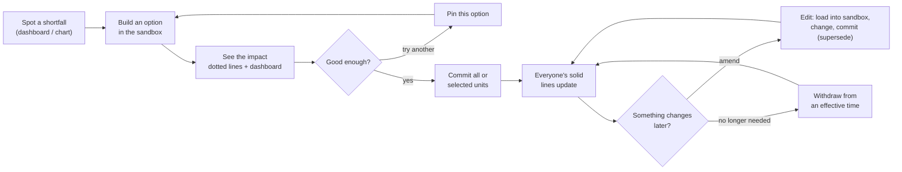

# Planning Workflow: Business Requirements

**Status:** draft for review. **Scope:** the planning workflow: how operators explore options, see their impact, commit to a shared plan, amend it, and (in later phases) compare and share options. **Companion:** the design behind each requirement is in [`drafts-architecture.md`](drafts-architecture.md) ("Arch §…"), with diagrams in [`drafts-architecture-diagrams.html`](drafts-architecture-diagrams.html).

**How to read the requirements**

| Field | Meaning |
|---|---|
| **ID** | Category prefix + number, e.g. `CMT-03`. Stable: IDs are never reused |
| **Requirement** | What the system shall do, stated from the business point of view |
| **Description** | Why it matters and how to recognise that it is met (acceptance notes) |
| **Phase** | 1 = day one · 2 = multiple drafts · 3 = sharing · 4 = later enhancements · F = future (design for it now, don't build) |
| **Pri.** | **M** must · **S** should · **C** could (within its phase) |
| **Trace** | Architecture section, design decision (D…), or open item (C…) the requirement depends on |

Requirements marked **⚑** depend on a decision that is still open. They are written to the current recommendation and listed again in §7.

---

## 1. Business context

### 1.1 The problem

Control-room operators must keep the system secure across several areas at once: margin, reserves, response, inertia and voltage. When the outlook shows a shortfall, an operator considers which units to bring on, when, and for which purpose. Before committing, they need to see what each option would do across every area. Once they commit, every other operator must see the same plan immediately, and the record of what was planned must never be lost or rewritten.

### 1.2 Business goals

| # | Goal |
|---|---|
| G1 | Let an operator **try options safely**: see their impact before committing, without affecting anyone else |
| G2 | Give every operator **one shared, consistent plan** and the same numbers |
| G3 | Let operators **amend the plan without creating false alarms** for colleagues |
| G4 | Keep a **complete, trustworthy record**: what was planned, by whom, when and why, and what it replaced |
| G5 | **Support better decisions over time**: compare options (Phase 2), share them (Phase 3), and test them against several futures (scenarios, later) |

### 1.3 Users

| Role | Who | What they need from the planning workflow |
|---|---|---|
| **Operator** | Control-room operators, working on a desk (e.g. NSE, OSM) | Build options in their sandbox, see impact, commit, amend and withdraw their own commitments |
| **Senior operator** | Shift leads | Everything an operator does, plus amend or withdraw another operator's commitment (e.g. after a shift change), always with a reason |
| **Policy owner** | Named owner of planning policy | Change reserve % and requirement rules: versioned, never retroactive, visible to everyone |
| **Viewer** | Anyone who needs to see the plan | See the committed plan, its history and the numbers, without changing anything |
| **Admin** | System administrators | User and role administration. Not a substitute for the policy owner |

### 1.4 Key terms

| Term | Meaning |
|---|---|
| **Sandbox** | An operator's private working area. Day one has one per operator (plus one for historical analysis) |
| **Draft** | A named working area (Phase 2). The sandbox is a special case of a draft |
| **Action** | One unit inside a sandbox or draft: window, output, reasons, event type, note |
| **Commitment** | The record created when units are committed: name, description, units, unit data at the time |
| **Committed plan** | All commitments currently in force. One plan for everyone |
| **Dotted line** | The impact of the sandbox or a draft, drawn on top of the committed plan's solid lines |
| **Effective time** | The half-hour boundary from which a change to an existing commitment applies. Never in the past |
| **Scenario** | One set of input values: demand, renewables and requirement values. Day one has one ("central") |
| **Planning policy** | Global rules applied to every scenario: reserve % and requirement rules |

---

## 2. User journeys

These journeys describe the intended experience. Each step lists the requirements that make it possible.

### 2.1 Overview

### 2.2 Journey 1 (day one): close a shortfall

*NSE sees margin falling short between 17:00 and 19:00 this evening.*

| # | The operator… | The system… | Requirements |
|---|---|---|---|
| 1 | Opens the dashboard and sees the margin tile in shortfall for 17:00–19:00 | Shows the current plan's figures for every area | VIS-03 |
| 2 | Adds DRAXX-1 and CNQPS-2 to their sandbox for 17:00–19:00, with reason Margin | Saves the sandbox on the server as each change is made | SBX-01, SBX-02, ACT-01–ACT-04 |
| 3 | Looks at the charts and the dashboard | Draws a dotted line over 17:00–19:00 on every area chart, and shows with-sandbox figures on the dashboard tiles | VIS-01, VIS-02, VIS-03 |
| 4 | Pins this option and tries PEHE-1 instead of CNQPS-2 | Keeps the pinned option as a faded line and fills a "pinned vs now" panel per area | CMP-01, CMP-02 |
| 5 | Decides the first option was better, switches back and opens Commit | Shows the impact against the latest data, flags anything that changed since the last edit, and lists warnings | CMT-02, CMT-05, CMT-06 |
| 6 | Names the commitment ("Evening margin cover"), adds a description, acknowledges a notice-time warning for CNQPS-2 and commits | Rejects nothing in the past, records the warning, creates the commitment and adds it to the plan | CMT-01, CMT-03, CMT-04, TIM-01–TIM-04 |
| 7 | Sees the dotted line turn solid. The sandbox is empty again | Notifies every operator. Their solid lines update within seconds | PLN-01, PLN-05, SBX-05 |

### 2.3 Journey 2 (day one): commit only part of an option

*NSE has five units in the sandbox but is only sure about two.*

| # | The operator… | The system… | Requirements |
|---|---|---|---|
| 1 | Selects two units and commits them | Commits only those two, as one commitment | CMT-01, CMT-02 |
| 2 | Keeps working on the remaining three | Leaves the unselected units in the sandbox, still drawn as a dotted line | SBX-05 |

### 2.4 Journey 3 (day one): amend a commitment without a false alarm

*At 16:10, DRAXX-1 (committed 15:00–19:00) is only needed until 18:00.*

| # | The operator… | The system… | Requirements |
|---|---|---|---|
| 1 | Presses **Edit** on the commitment. Their sandbox already has work, so a warning appears, and they continue | Loads DRAXX-1 into the sandbox, marked "editing committed", with effective time 16:30 (the next half-hour) | AMD-01, AMD-02, AMD-03 |
| 2 | Changes the end time to 18:00 | Draws the plan *with DRAXX-1 replaced*, not added twice. Colleagues still see the original commitment: no gap, no false shortfall | AMD-04, VIS-04 |
| 3 | Commits | In one step, keeps 15:00–16:30 exactly as it was, closes the rest, and adds 16:30–18:00. The other units in the sandbox are committed alongside, each from its own window | AMD-05, TIM-05, TIM-06 |
| 4 | Checks the history | Shows that the original was partly replaced, by whom, when and why | PLN-03, PLN-04, AMD-07 |

### 2.5 Journey 4 (day one): withdraw, or a shift lead steps in

| # | The user… | The system… | Requirements |
|---|---|---|---|
| 1 | An operator withdraws a commitment that's no longer needed, giving a reason | Closes it from the effective time (default next half-hour). Earlier half-hours stay in the record | AMD-06, TIM-01 |
| 2 | A senior operator edits a commitment owned by an operator who has gone off shift | Loads it into the senior's own sandbox. Requires a reason. Notifies the owner | ACC-03, AMD-01, PLN-06 |

### 2.6 Journey 5 (day one): a clash

*OSM tries to commit SHBA-1 for 06:00–09:00, but NSE has already committed it for 07:00–10:00.*

| # | The operator… | The system… | Requirements |
|---|---|---|---|
| 1 | Commits | Rejects the commit and names NSE's commitment that holds SHBA-1 | CMT-07 |
| 2 | Needs SHBA-1 for response as well as NSE's purpose | Edits NSE's commitment (if permitted) to add the reason Response, instead of committing a duplicate | ACT-03, AMD-01, ACC-03 ⚑ |

### 2.7 Journey 6 (day one): look back at a past day

| # | The operator… | The system… | Requirements |
|---|---|---|---|
| 1 | Switches to historical mode for yesterday | Opens their historical sandbox (separate from the live one), evaluated against what actually happened | HIS-01, HIS-02 |
| 2 | Tries a what-if option and pins it | Shows requirements as they were at the time, or "unavailable" where none were recorded | HIS-03, CMP-01 |
| 3 | Tries to commit | Commit isn't available: historical work never changes the plan | HIS-04 |

### 2.8 Journey 7 (day one): a policy change

| # | The user… | The system… | Requirements |
|---|---|---|---|
| 1 | The policy owner changes reserve % from 10 to 12, effective from 18:00 | Creates a new policy version and refuses any time in the past | POL-01, POL-02 ⚑ |
| 2 | Operators keep working | Every screen shows a "policy changed" notice. Figures from 18:00 use the new policy | POL-03 |

### 2.9 Journey 8 (Phase 2): compare two options side by side

| # | The operator… | The system… | Requirements |
|---|---|---|---|
| 1 | Creates two named drafts, A and B | Gives each its own colour and dotted line, and lets the operator show or hide each one | DRF-01, DRF-02, DRF-03 |
| 2 | Opens **Compare** | Shows a table with drafts as columns and areas as rows: worst headroom, half-hours short, units and MW, indicative cost, clashes, warnings | CMP-03 |
| 3 | Chooses **Preview together** | Adds a read-only "A + B" column and line, counting a unit only once | CMP-04 |
| 4 | Commits A, and discards B | A enters the plan. B can be restored later | CMT-01, DRF-04 |

### 2.10 Journey 9 (Phase 3): share an option

| # | The user… | The system… | Requirements |
|---|---|---|---|
| 1 | NSE shares Draft A with OSM (or the whole OSM desk) | Notifies OSM | SHR-01, SHR-02, SHR-05 |
| 2 | OSM views it | Shows Draft A's dotted line read-only | SHR-03 |
| 3 | OSM duplicates it to try a variation | Creates OSM's own editable copy | SHR-04 |

### 2.11 Future journey: test options against several futures

*A scenario generator supplies "central", "low wind, evening peak" and "cold snap".*

The operator evaluates their drafts against all three. The comparison table extends to drafts × areas × scenarios and highlights options that work in more than one scenario. Not built now. Phase 1 only builds the foundations (SCN-01–SCN-04).

---

## 3. Functional requirements

### 3.1 Sandbox and work in progress (SBX)

| ID | Requirement | Description | Phase | Pri. | Trace |
|---|---|---|---|---|---|
| SBX-01 | Each operator shall have one private **sandbox** for live planning | The operator's single working area on day one. Nobody else can see it, including senior operators (D28) | 1 | M | Arch §9.1, §9.2, D25 ⚑ |
| SBX-02 | The sandbox shall be **saved on the server** as the operator works | Work survives a page refresh, browser restart, new market data and logging in elsewhere. Losing work damages trust | 1 | M | N1, Arch §9.5 |
| SBX-03 | The operator shall be able to **clear** the sandbox without committing | One action empties it. Loaded commitments are left untouched in the plan | 1 | M | Arch §9.5 |
| SBX-04 | Each operator shall have a **separate historical sandbox** | Historical what-if work never mixes with live work (see HIS) | 1 | M | Arch §4.5, C10 |
| SBX-05 | After a commit, the sandbox shall keep only the **units that were not committed** | Commit all leaves it empty. Partial commit keeps the rest for further work | 1 | M | D15, Arch §9.7 |
| SBX-06 | Concurrent edits from the same operator in two windows shall **not overwrite each other silently** | The second save is rejected with a message, and the window reloads the latest version | 1 | M | N7, Arch §14.1 |

### 3.2 Units and actions (ACT)

| ID | Requirement | Description | Phase | Pri. | Trace |
|---|---|---|---|---|---|
| ACT-01 | The operator shall be able to **add and remove units** in the sandbox | Each added unit becomes one action (row) | 1 | M | Arch §2.4 |
| ACT-02 | A unit shall appear **at most once** in a sandbox or draft | Adding it again changes nothing | 1 | M | I6 |
| ACT-03 | Each action shall have its own **window, output, reasons, event type and note** | The window's end can be left open (until the end of the horizon). New actions start from a default window | 1 | M | F2, Arch §2.4 |
| ACT-04 | Each action shall carry **one or more reasons** (Margin, Recovery / Freq. Control / General / Contingency Reserve, Response, Inertia, Voltage) | One unit, one commitment, many reasons. A unit can't be saved without at least one reason | 1 | M | I7, Arch §5.3 |
| ACT-05 | Windows shall refer to **real half-hours** | A window always means the same half-hour, whatever the date or clock change (46/50-SP days), and is shown as settlement date + SP | 1 | M | N8, Arch §3 |
| ACT-06 | Actions whose window has fully passed shall be shown as **expired** | Expired actions are left out of forward-looking figures. A sandbox or draft with only expired actions is flagged "Expired" | 1 | S | Arch §3 |

### 3.3 Impact visualisation (VIS)

| ID | Requirement | Description | Phase | Pri. | Trace |
|---|---|---|---|---|---|
| VIS-01 | Work in progress shall be drawn as a **dotted line** on the margin and area charts, updating **instantly** as the operator edits | The dotted line is the committed plan plus the sandbox's extra units. It appears only over the half-hours the sandbox changes, joined to the solid line at each end | 1 | M | F3, Arch §6.1 |
| VIS-02 | The **committed plan** shall be drawn as solid lines, the same for every operator | Solid = units already running + committed plan | 1 | M | N5, Arch §6.1 |
| VIS-03 | **Dashboard tiles** shall show the current-plan figure and the with-sandbox figure | So the impact on every area is visible at a glance on day one | 1 | M | F9, D13, Arch §7.4 |
| VIS-04 | Loaded (amended) units shall be drawn as a **replacement** for the commitment they change | The line shows the plan with the change, not the original plus a second copy | 1 | M | Arch §6.2 |
| VIS-05 | A unit shall **never be counted twice** in the same half-hour | A unit already running, or already committed, adds nothing more | 1 | M | Arch §6.2 |
| VIS-06 | If a unit in the sandbox becomes committed by someone else, the sandbox shall **flag it** | E.g. "already committed by OSM at 14:32. Edit that commitment to change it". The dotted line stops counting it | 1 | S | Arch §6.3 |
| VIS-07 | Missing requirement values shall be shown as **unavailable**, never as zero | No requirement line and an "unknown" status for those half-hours | 1 | M | C13, Arch §6.2 |
| VIS-08 | Each unit's contribution shall be shown as a **flat block** over its window ⚑ | Pending D14: a notice-and-ramp profile may replace this. The design keeps that option open | 1 | M | D14, Arch §6.4 |

### 3.4 Comparing options (CMP)

| ID | Requirement | Description | Phase | Pri. | Trace |
|---|---|---|---|---|---|
| CMP-01 | The operator shall be able to **pin** the sandbox's current impact as a reference | One pin per sandbox. Pinning again replaces it. Shown as a faded line. Display only: never committable, never shared | 1 | M | F13, D27, Arch §9.8 |
| CMP-02 | A **"pinned vs now" panel** shall show worst headroom per area for the pinned and current states | Shows when the pin was taken and flags it as stale when the data has moved on. The pin is not recalculated | 1 | M | C6, Arch §9.8 |
| CMP-03 | The operator shall be able to **compare drafts** in a table: drafts as columns, areas as rows | Rows: worst headroom per area vs current plan, half-hours still short, units and MW added, indicative cost (labelled indicative), units that would clash, warnings. A draft with loaded units is shown as a change against what it replaces | 2 | M | F10, Arch §7.1 |
| CMP-04 | The operator shall be able to **preview two or more drafts together**, read-only | Adds an "A + B" line and column, never stored. A unit in both drafts is counted once. If its settings differ, it is flagged | 2 | S | F11, Arch §7.2 |
| CMP-05 | The operator shall be able to **freeze market data** while comparing | Holds the display on one data snapshot with a banner. Commit always uses the latest data | 4 | C | C7, Arch §7.3 |

### 3.5 Commit (CMT)

| ID | Requirement | Description | Phase | Pri. | Trace |
|---|---|---|---|---|---|
| CMT-01 | The operator shall be able to **commit** sandbox units into the shared plan | Creates a **commitment** record. Its contents never change afterwards | 1 | M | F5, I4, Arch §5.1 |
| CMT-02 | The operator shall be able to commit **all or only selected** units | Default: all. Unselected units stay in the sandbox | 1 | M | D15 |
| CMT-03 | The commit dialog shall require a **name and description** | The description explains *why* (e.g. "cover the 17:00 margin dip after the CCGT trip"). Shown in history and blame | 1 | M | Arch §13 |
| CMT-04 | A commit shall be **all or nothing** | Either every selected change is applied as one new plan version, or none is | 1 | M | Arch §14.3 |
| CMT-05 | The commit dialog shall show the **impact against the latest data** and flag a **material change** since the sandbox was last edited | E.g. an area's status changes, or headroom moves by more than a configurable threshold | 1 | M | Arch §7.3 |
| CMT-06 | The commit dialog shall list **warnings** that must be acknowledged | Gate closure and unit notice time (TIM-03, TIM-04). Acknowledgements are recorded | 1 | M | D17 |
| CMT-07 | A commit that would give a unit **two overlapping commitments** shall be **rejected** | The message names the existing commitment and its owner, and suggests editing it. Safe even when two operators commit at the same moment | 1 | M | D18, I3, N7 |
| CMT-08 | Commit may require **senior approval** ⚑ | Only if D4 decides so | 4 | C | D4 |

### 3.6 Amend and withdraw (AMD)

| ID | Requirement | Description | Phase | Pri. | Trace |
|---|---|---|---|---|---|
| AMD-01 | **Edit** on a commitment shall load it, or selected units of it, into the operator's sandbox | The familiar "Edit" button, implemented as load + supersede. The commitment record itself is never edited | 1 | M | D16, D20 ⚑ |
| AMD-02 | Loading into a sandbox that isn't empty shall show a **warning** | The operator can cancel, clear first, or continue. Continuing is safe (see TIM-05) | 1 | M | C4, Arch §4.3 |
| AMD-03 | Loaded units shall be clearly marked **"editing committed"**, each with its **effective time** | Default effective time: the next half-hour, editable per unit | 1 | M | Arch §4.3 |
| AMD-04 | While being edited, the commitment shall **stay in the plan** | Colleagues see no gap and no false shortfall | 1 | M | D16 |
| AMD-05 | Committing loaded units shall **replace** the original in one step | From each unit's effective time. The past part stays exactly as committed | 1 | M | D16, Arch §5.4 |
| AMD-06 | The operator shall be able to **withdraw** a commitment, or selected units of it, with a **reason** | Applies from an effective time per unit (default next half-hour) | 1 | M | Arch §4.2, §14.4 |
| AMD-07 | A commitment with only some units replaced or withdrawn shall show as **"partly amended"** | Fully replaced: "superseded". Fully withdrawn: "withdrawn" | 1 | M | C3, Arch §4.1 |
| AMD-08 | Deleting a loaded unit in the sandbox shall mark it **for withdrawal** at commit | Shown struck through | 1 | M | Arch §4.3 |
| AMD-09 | If someone else changes the same commitment first, the commit shall **fail with a clear message** | The operator reloads and tries again. Nothing is overwritten silently | 1 | M | N7, Arch §4.3 |

### 3.7 Time rules (TIM)

| ID | Requirement | Description | Phase | Pri. | Trace |
|---|---|---|---|---|---|
| TIM-01 | No change shall touch a half-hour that has **already started** | Hard rule. The earliest effective time is the start of the next half-hour | 1 | M | D17, I5 |
| TIM-02 | A new unit's window shall be **clipped** to start no earlier than the next half-hour | A window entirely in the past can't be committed | 1 | M | Arch §4.4 |
| TIM-03 | A change inside **gate closure** for that half-hour shall give a **warning** | About 1 hour before delivery. Acknowledge to continue | 1 | M | D17 |
| TIM-04 | A change sooner than the unit's **notice time** (NDZ) shall give a **warning** | For units being added or extended. Acknowledge to continue | 1 | M | D17 |
| TIM-05 | Effective times shall be set **per amended unit**, not per commit | One commit can amend several units at different times, add new units and withdraw others | 1 | M | C4 |
| TIM-06 | A commitment row that spans an effective time shall be **split** | The part before stays as it was, the part after is replaced or closed | 1 | M | Arch §4.4 |
| TIM-07 | Minimum run and off times shall give **warnings** ⚑ | Only if D14 chooses unit profiles | F | C | D14 |

### 3.8 Committed plan, history and audit (PLN)

| ID | Requirement | Description | Phase | Pri. | Trace |
|---|---|---|---|---|---|
| PLN-01 | There shall be **one committed plan** for all operators | Everyone sees the same solid lines and figures | 1 | M | D3 ⚑, N5 |
| PLN-02 | The committed plan shall **never be rewritten** | Changes only add new rows or close existing ones. Each change is a new plan version | 1 | M | I1, I2, Arch §5.1 |
| PLN-03 | It shall be possible to show **the plan as it was** at any past time or version | Exact, not reconstructed. Query on day one, screen in Phase 4 | 1 / 4 | M | N6, Arch §5.5 |
| PLN-04 | For any unit and half-hour, it shall be possible to see **who committed it, when, why, and what it replaced** ("blame") | Query on day one, screen in Phase 4 | 1 / 4 | M | Arch §5.5 |
| PLN-05 | Plan changes shall reach **every operator's screen within about two seconds** | Without refreshing | 1 | M | N2 |
| PLN-06 | Owners shall be **notified** when someone else edits or withdraws their commitment | E.g. "Your commitment was edited by NSE" | 1 | S | Mental model |
| PLN-07 | A **Committed** screen shall list commitments with their units, reasons and owners | Grouped by commitment. Per-reason totals list a unit under each of its reasons, while the overall total counts it once, and the screen says so | 1 | M | Arch §5.3 |
| PLN-08 | Committed units shall show **↑/↓ indicators** when their unit data has moved materially since commit | Unit data is recorded at commit time | 1 | S | F8 |
| PLN-09 | **Every command** shall be recorded in the audit trail | Who, when, what, before and after. Warnings acknowledged. Never edited or deleted | 1 | M | N6 |
| PLN-10 | Each plan change shall record the **scenario and policy version** it was checked against | So past decisions can be understood in context | 1 | M | I10 |
| PLN-11 | The plan shall leave room to record whether a commitment was **instructed and delivered** | Not built in Phase 1 | F | C | D19 |

### 3.9 Historical analysis (HIS)

| ID | Requirement | Description | Phase | Pri. | Trace |
|---|---|---|---|---|---|
| HIS-01 | The operator shall be able to work in a **historical** window | Through their historical sandbox (SBX-04) | 1 | M | Arch §4.5 |
| HIS-02 | Historical work shall be evaluated against an **outturn scenario** | Actual demand and renewables, treated as facts | 1 | M | C10 |
| HIS-03 | Historical requirements shall be **the ones in force at the time** | Recovered from kept scenario versions. "Unavailable" where none exists. Complete from go-live | 1 | M | C13, C15 ⚑ |
| HIS-04 | A historical sandbox shall **not be able to commit** | Its purpose is analysis and replay. The pin covers comparison | 1 | M | D10 |
| HIS-05 | A **practice plan** for training may be offered | Separate from the live plan | 4 | C | D10 |

### 3.10 Multiple drafts (DRF)

| ID | Requirement | Description | Phase | Pri. | Trace |
|---|---|---|---|---|---|
| DRF-01 | Operators shall be able to keep **several named private drafts** alongside the sandbox | Lifts the one-sandbox rule | 2 | M | F1, Arch §9.9 |
| DRF-02 | Each draft shall have its own **colour and dotted line** | — | 2 | M | Arch §9.9 |
| DRF-03 | The operator shall be able to **show or hide** each draft's line | — | 2 | M | F4 |
| DRF-04 | The operator shall be able to **rename, describe, duplicate, discard, restore and delete** drafts | Discarded drafts can be restored. Delete is permanent | 2 | M | F1 |
| DRF-05 | Committing, editing and withdrawing shall work the same from a draft as from the sandbox | Same rules (CMT, AMD, TIM) | 2 | M | Arch §15 |

### 3.11 Sharing (SHR)

| ID | Requirement | Description | Phase | Pri. | Trace |
|---|---|---|---|---|---|
| SHR-01 | The owner shall be able to **share** a draft with named operators | And remove access again | 3 | M | F7 |
| SHR-02 | The owner shall be able to share with a **desk** | Access follows current desk membership | 3 | S | D8 |
| SHR-03 | Recipients shall see shared drafts **read-only**, in a "Shared with me" list, with their dotted line | Only the owner can change a draft | 3 | M | F7, Arch §8 |
| SHR-04 | Recipients shall be able to **duplicate** a shared draft into their own | Their copy is private until they share it | 3 | M | F7 |
| SHR-05 | Recipients shall be **notified** when a draft is shared with them | — | 3 | S | Mental model |
| SHR-06 | Recipients may **comment** on a shared draft | — | 4 | C | Mental model |
| SHR-07 | Senior operators may see all open drafts ⚑ | Only if D7 decides so. Default: private unless shared | 3 | C | D7 |

### 3.12 Scenarios (SCN)

| ID | Requirement | Description | Phase | Pri. | Trace |
|---|---|---|---|---|---|
| SCN-01 | All figures shall be calculated against an explicit **scenario**. Day one has one live scenario ("central") | So more scenarios can be added later without a redesign | 1 | M | N10, Arch §10.4 |
| SCN-02 | **Facts** (market participants' data), **scenario input values** and **planning policy** shall be kept separate | They meet only in the calculation | 1 | M | Arch §10.4 |
| SCN-03 | Scenarios shall be **versioned and read-only** | A new forecast creates a new version | 1 | M | D24 |
| SCN-04 | Operator-entered **requirement values** shall be inputs of the central scenario, marked as manual | Entered on the Requirements screen | 1 | M | C9 |
| SCN-05 | Operators shall be able to evaluate drafts against **several scenarios** and see which options are **robust** | Future capability | F | C | Arch §10.3, D21 ⚑ |
| SCN-06 | **Manual what-if scenarios** shall be clearly labelled as user-defined | Future capability | F | C | D22 |

### 3.13 Planning policy and availability data (POL)

| ID | Requirement | Description | Phase | Pri. | Trace |
|---|---|---|---|---|---|
| POL-01 | Only the **policy owner** shall be able to change planning policy (reserve %, requirement rules) | Not admins, not senior operators | 1 | M | C14 |
| POL-02 | A policy change shall take effect **from a stated time**, never retroactively ⚑ | Current assumption: half-hours from that time use the new policy (C16) | 1 | M | C14, C16 |
| POL-03 | Every screen shall show a **"policy changed"** notice when policy changes | Versioned and audited | 1 | M | C14 |
| POL-04 | **Contracted** availability values shall be global, audited facts | — | 1 | M | C12 |
| POL-05 | **Constraint** values shall be global, audited manual overrides | Who may edit them is open (C17) | 1 | M | C12, C17 ⚑ |

### 3.14 Roles and access (ACC)

| ID | Requirement | Description | Phase | Pri. | Trace |
|---|---|---|---|---|---|
| ACC-01 | Users shall **sign in with single sign-on** | No self-selected identity | 1 | M | N3 |
| ACC-02 | Permissions shall be **enforced by the server** | Not just hidden in the screen | 1 | M | N4 |
| ACC-03 | Owners and senior operators shall be able to edit or withdraw a commitment, **with a reason** ⚑ | Seniors work through their own sandbox. Per D6 | 1 | M | D6, Arch §8 |
| ACC-04 | Everyone with access shall be able to **see the committed plan, its history and blame** | Including viewers | 1 | M | Arch §8 |
| ACC-05 | A user may hold **more than one role** | E.g. operator and policy owner | 1 | M | Arch §13 |

---

## 4. Business rules

Rules that apply across the requirements above.

| ID | Rule | Trace |
|---|---|---|
| BR-01 | A unit appears at most once in a sandbox or draft | I6 |
| BR-02 | A unit can have only one commitment at any moment | D18, I3 |
| BR-03 | Nothing that has already started can be changed | D17, I5 |
| BR-04 | A commitment's contents never change. It can only be replaced or withdrawn, from an effective time | I4 |
| BR-05 | Every action has at least one reason | I7 |
| BR-06 | Reasons don't change the calculation: a committed unit counts towards every area it physically contributes to | Arch §5.3 |
| BR-07 | One live sandbox and one historical sandbox per operator on day one | I8 |
| BR-08 | Historical work never changes the live plan | D10 |
| BR-09 | Planning policy applies to every scenario and is never changed retroactively | C14 |
| BR-10 | Missing data is shown as unavailable, never invented | C13 |

---

## 5. Non-functional requirements

| ID | Requirement | Description | Trace |
|---|---|---|---|
| NFR-01 | **Persistence** | Work and the plan survive refreshes, restarts and new data | N1 |
| NFR-02 | **Consistency** | All operators see figures from the same inputs and plan version | N5 |
| NFR-03 | **Responsiveness** | Dotted lines update instantly while editing. Plan changes reach other screens in about 2 s | N2, Arch §17 |
| NFR-04 | **Availability** | Suitable for a control room. Read-only fallback with a banner if the server is unreachable. Target to be agreed | N9, D12 ⚑ |
| NFR-05 | **Audit and history** | Complete, append-only, and kept for an agreed retention period | N6, C15 ⚑ |
| NFR-06 | **Time correctness** | Real half-hours, including clock-change days | N8 |
| NFR-07 | **Security** | Single sign-on, server-side permissions. Plans are operationally sensitive | N3, N4 |

---

## 6. Out of scope for this document

- How each area's availability is calculated (margin, reserves, response, inertia, voltage formulas).
- Dashboard and chart layouts beyond showing the sandbox's impact.
- Instructing units, or tracking instruction and delivery (room is left: PLN-11).
- Automatic search or optimisation for options.
- Generating scenarios (the system consumes them).

---

## 7. Requirements that depend on open decisions

| Requirement(s) | Depends on | Question |
|---|---|---|
| SBX-01 and the day-one model | D25 | Sandbox on day one (needs stakeholder agreement) |
| AMD-01 | D20 | "Edit" as load + supersede (operator sign-off) |
| ACC-03 | D6 | Who can edit or withdraw another operator's commitment |
| CMT-08 | D4 | Senior approval before commit |
| PLN-01 | D3 | One shared plan, or per-desk plans |
| VIS-08, TIM-07 | D14 | Flat block or notice/ramp profile |
| SHR-07 | D7 | Senior visibility of open drafts |
| SCN-05 | D21 | What a scenario may vary |
| POL-02 | C16 | What "takes effect from a stated time" means |
| POL-05 | C17 | Who edits availability data |
| HIS-03, NFR-05 | C15 | Retention for complete history and replay |
| NFR-04 | D12 | Availability target |
